<div align="center">

[中文](./README.md)

# 🛠️ dsh-service

<p align="center">
  <strong>A service-control &amp; operations plugin for DeepSeek Harness (DSH) Web.</strong><br>
  <em>DeepSeek Harness (DSH) Web 服务控制与运维插件。</em>
</p>

[](package.json)
[](LICENSE)
[](https://github.com/deepseek-ai/deepseek-harness)
[](https://cordis.moe/)
[](https://github.com/gehennawu/dsh-service)
[](https://github.com/gehennawu/dsh-service/issues)
[](https://awesome-dsh-plugin.com)

<p align="center">
  <a href="#-features">Features</a> •
  <a href="#-architecture">Architecture</a> •
  <a href="#-installation">Installation</a> •
  <a href="#-automatic-restart">Automatic restart</a> •
  <a href="#-platform-support">Platform support</a> •
  <a href="#-security-design">Security design</a> •
  <a href="#-faq">FAQ</a> •
  <a href="#-contributing">Contributing</a> •
  <a href="#-license">License</a>
</p>

---

</div>

A service-control and operations plugin for DSH Web: safe restart, version management and one-click upgrade, health diagnostics, model-usage statistics, quota lookup, backup management, task notifications, skills management, session management, and Linux file-permission maintenance.

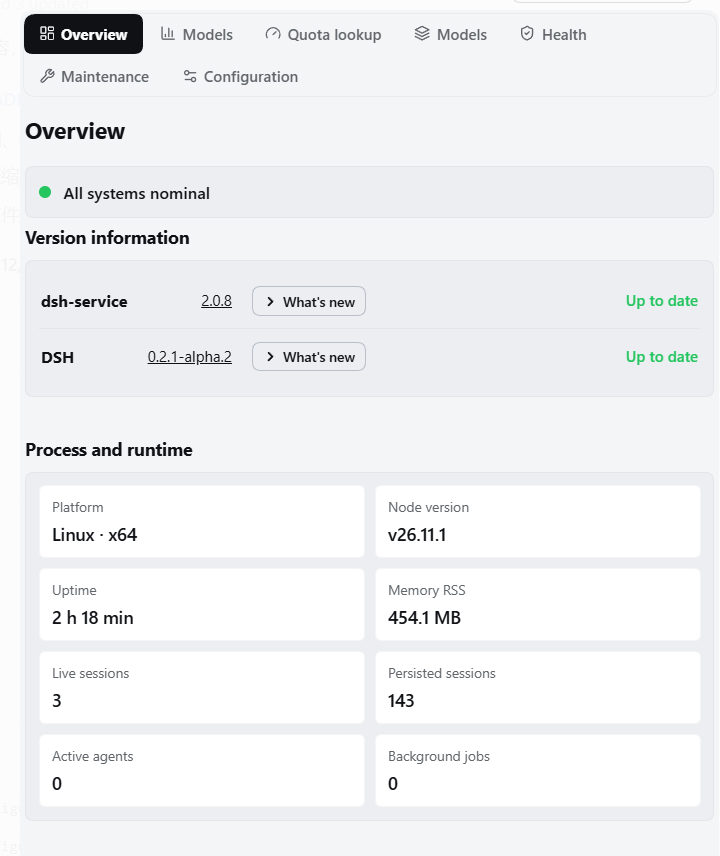

## 📑 Contents

- [🚀 Features](#-features)
  - [Version and updates](#version-and-updates) · [Safe restart](#safe-restart) · [Health diagnostics](#health-diagnostics) · [Model statistics](#model-statistics)
  - [Quota lookup](#quota-lookup) · [Model configuration](#model-configuration) · [Backup management](#backup-management) · [Skills management](#skills-management) · [Subagent model](#subagent-model)
  - [Task notifications](#task-notifications) · [Session manager](#session-manager) · [Mobile adaptation](#mobile-adaptation) · [Sidebar settings entry](#sidebar-settings-entry) · [Model provider icons](#model-provider-icons) · [Right-Sidebar file editing](#right-sidebar-file-editing) · [External liveness probe](#external-liveness-probe)
- [🏗️ Architecture](#-architecture)
- [⚡ Installation](#-installation) · [🔄 Automatic restart](#-automatic-restart) · [🖥️ Platform support](#-platform-support)
- [🔒 Security design](#-security-design) · [❓ FAQ](#-faq) · [🤝 Contributing](#-contributing) · [📄 License](#-license)

## 🚀 Features

The Settings "Service Control" panel has a seven-page navigation: **Overview · Model stats · Quota lookup · Model configuration · Health · Maintenance · Configuration**; "Model configuration" contains Providers & models / Subagent routing, "Maintenance" aggregates four subpages — Sessions · Skills · Backups · Restart — and "Configuration" aggregates Features · Task notifications · Settings Nav. Restart, Quota lookup, and Sessions can each enable a **quick entry in the settings left navigation** (off by default; the Skills and Subagents sidebar entries were removed).

Under **Plugins → Plugin configuration**, thirteen host-level switches: **Health diagnostics, Model statistics, Quota lookup, Model configuration, Backup maintenance, Task notifications, Skill manager, Subagent model, Session manager, Mobile adaptation, Model provider icons, Right-Sidebar file editing, `/healthz` liveness endpoint** (all on by default except Mobile adaptation). All are live settings: disabling hides the UI, stops polling/subscriptions, and makes the host reject that capability; Overview and Restart stay available.

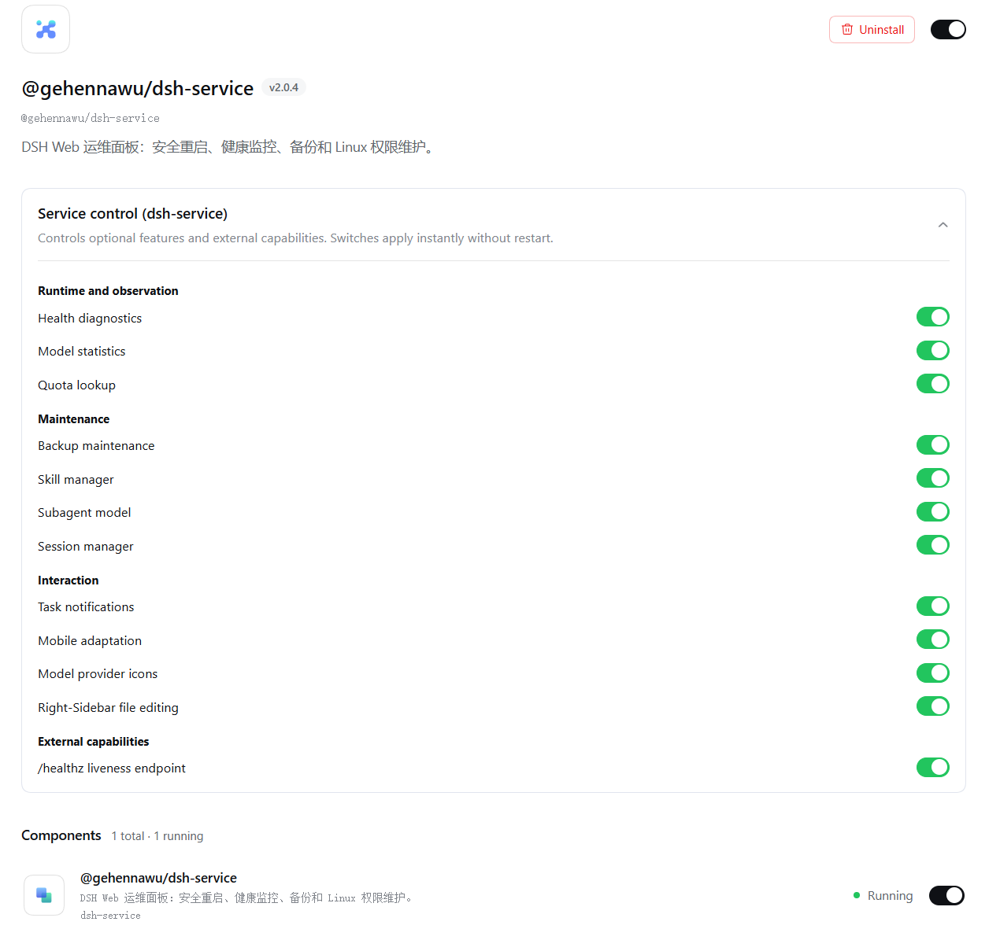

### Overview

- View service status, actionable issues, DSH / plugin versions, runtime and recent errors.
- Health, backup, statistics and quota failures surface as alerts; available updates and missing backups are informational.

### Maintenance and Configuration pages

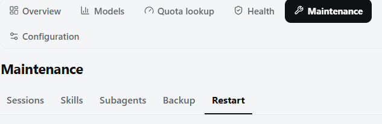

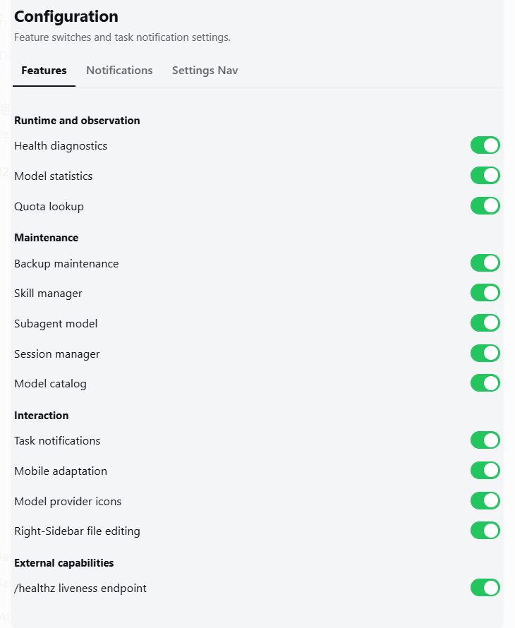

- Maintenance groups Sessions, Skills, Backups and Restart, remembering the latest subpage.
- Configuration groups feature switches, notifications and settings-navigation tabs, with drag / arrow ordering and visibility controls. Service Control always remains visible.
- Navigation and quota-card preferences sync across devices through `$DSH_HOME/dsh-service-config.json`; feature sections do not affect one another.

### Version and updates

- Shows the current DSH and plugin versions, linking to GitHub Releases
- Automatically checks npm **stable + preview** (latest / next dist-tags)
- "What's new" opens release notes for the running version; an available-update link opens the new release notes in place. Press Escape to close.
- One-click upgrade with automatic restart; when no process manager is detected, it confirms the consequences first, keeps running, and shows manual-restart instructions
- Between the upgrade landing and the process restart (common in a manual-launch environment) the version row reads "Installed X — restart to take effect" and the upgrade button is withdrawn; reopening the panel or refreshing the page keeps that state until the process is restarted

### Safe restart

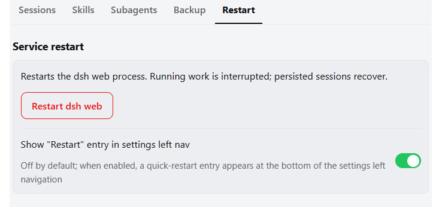

- Detects active agents, background jobs, and terminals before restart; lists them and requires explicit confirmation
- `/restart` also works in conversations; automatically refuses while work is running
- Probes the new process after restart and reloads the page; manual reload offered after 60 seconds. A restart triggered by `/restart` in a conversation reloads the same way: the page records the process identity at load time and compares `instanceId` on reconnect, reloading as soon as the new process is up
- Optional "Restart" entry in the settings left navigation (off by default), sharing the same confirmation flow as the "Maintenance → Restart" subpage
- A suspected manual terminal launch warns that nothing will bring the process back and gets a yellow caution in Health

### Health diagnostics

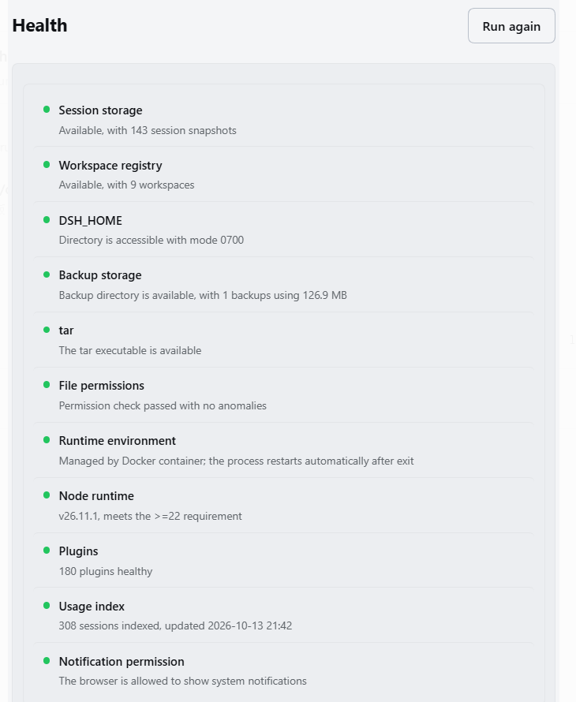

- View uptime, memory, sessions, active agents, background jobs, platform, architecture and Node version.
- Check session storage, workspace registry, backups, tar, file permissions, runtime and the usage index.
- **Usage index** reports indexed / failed sessions and update time. Partial failures do not block other sessions; disabling model statistics omits this check.
- **Notification permission** reports blocked or missing browser permission with recovery guidance; it does not affect overview status and is omitted when notifications are disabled.
- **Plugin health checks** list failures and missing dependencies; failed plugins can be reloaded after confirmation. Manually disabled plugins are not anomalies; disposed or unknown states are informational only.
- Permissions & repair provides deep scans and two-step permission repairs.
- Suspected manual launches warn of no restart assurance; missing backups are informational.

### Model statistics

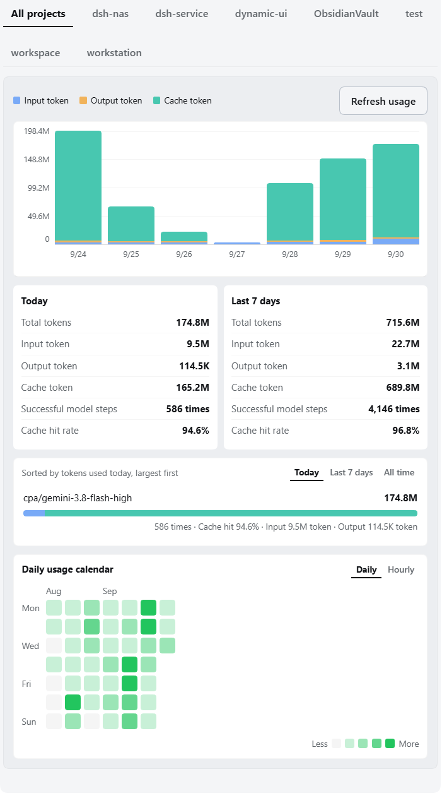

- Seven-day input / output / cache token trends, filtered by project. Hover for totals, successful model steps and cache hit rates.
- Per-model breakdowns switch between Today, Last 7 days and All time.
- A **daily usage heatmap** covers up to 20 weeks, with a weekday × hour view; both follow the project filter.
- **Indexed history is permanent**: deleting sessions or projects never subtracts usage. Deleted projects leave the filter but remain in overall totals.
- View model / tool errors from the last 48 hours; omitted when empty.
- Sync automatically on panel opening, page entry, local midnight and return to the foreground, or refresh manually. No idle polling.
- Steps without provider-reported tokens are excluded. Unreadable sessions retain stale cached data and are retried while other sessions continue; expand failure details, with new failures bringing the notice back.

### Quota lookup

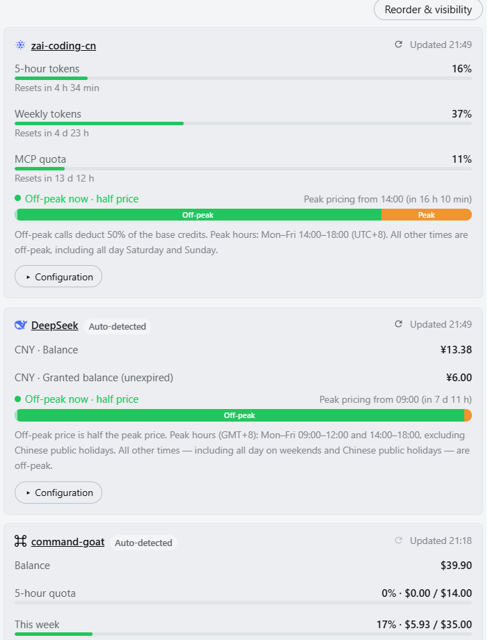

- Provider cards keep the existing window presentation (label + percent / independent bar / reset countdown); **configuration** (credentials, kind switching, manual reset entries) is collapsed per card by default
- Card **order and visibility**: "Reorder & visibility" on the quota page expands a management list where cards can be dragged or nudged with ↑/↓, and a toggle hides cards you rarely need (hiding only affects display, not querying); the config shares one backend with the Settings Nav tabs, stored in the `quotaCards` section of the unified server-side config `$DSH_HOME/dsh-service-config.json` (cross-device sync with a local-cache fallback, sections never affect each other)
- A **quota ring** in the conversation composer follows the current session's model provider and shows the tightest budget window (<80% green, ≥80% amber); clicking opens a detail panel that becomes a centered overlay on narrow screens
- Built-in adaptations:

| Provider | Data source |
| --- | --- |
| DeepSeek Platform | Official balance + peak/off-peak ribbon and countdown (peak = Mon–Fri 09:00–12:00 and 14:00–18:00 UTC+8, **excluding Chinese public holidays**; weekends and public holidays are off-peak all day) |
| Zhipu GLM Coding Plan | Official endpoint: 5-hour rolling / weekly / monthly MCP windows + peak/off-peak ribbon and countdown (peak = Mon–Fri 14:00–18:00 UTC+8) |
| OpenCode Go | `{baseURL}/usage` (built-in channel without an explicit baseURL uses the registry default `https://opencode.ai/zen/go/v1`) |
| OpenRouter | Credits used % |
| Kimi / SiliconFlow | CNY balance |
| Vercel AI Gateway | Official `GET /v1/credits` for the team's remaining USD balance (Gateway API key; lifetime spend is not a quota limit) |
| Poe | API-key query for remaining points (non-monetary; no currency gauge) |
| ClinePass | API-key query for 5-hour / weekly / monthly plan usage and reset times |
| StepFun Balance | Official `GET /v1/accounts` (API key, com/ai dual domains) |
| StepFun Step Plan | Console BFF subscription quota (Oasis-Token console session; 5-hour/weekly windows vs Credit pool auto-detected) |
| Xiaomi MiMo Token Plan | Console-origin plan quota (web session cookie) |
| Command Code (command-goat) | Official account quota plane `api.commandcode.ai/alpha/*` (same key reused: balance + period spend + plan + 5-hour/weekly windows) |
| CLIProxyAPI deployment | Official remaining quota of each OAuth upstream account |

- Credentials go into the DSH credential store (`$DSH_HOME/.credentials.yaml`, hot-effective): an API key, the CPA management key, the Xiaomi console cookie, or the StepFun Step Plan console token (Oasis-Token; the `Oasis-Webid` is derived from the token automatically — no manual entry); the Command Code quota plane reuses the inference key, so no extra credential is needed
- **Credentials can be changed at any time**: every adapted card keeps a credential entry in its **Config** area — unconfigured rows show the per-channel wording, configured rows show "Edit credential (configured)", where the stored value can be overwritten (key rotation, another account, a typo) or cleared; the value is only ever sent with the save request and is never echoed back
- Anti-rate-limit pacing: 60 s result cache, exponential backoff for transient network errors (30 s doubling, capped at 15 min); **deterministic failures switch to manual** — credential errors, 4xx, expired plans, management API disabled, unexpected response shapes and anything else only a config change can fix stop the automatic retries (the error line then reads "Auto-retry paused — retry manually"), and only a successful manual reconnect via the refresh button (5 s cooldown) returns the channel to automatic mode; querying is fully manual — a snapshot is fetched when you open the quota page, expand the ring, or hit refresh, and the client never arms a periodic poll (upstream throttling still lives entirely in the host)
- **CLIProxyAPI management-plane bans get their own notice**: five consecutive auth failures from one IP ban that IP for 30 minutes on the management plane; while banned the card reads "Temporarily banned by CLIProxyAPI" plus the upstream message (including the remaining time). That state offers no credential form (the key is fine) — wait for the ban to expire, or change the host's egress IP, then hit "Retry connection". The ban covers the management plane only; model inference through that CPA is unaffected
- CLIProxyAPI: when an account's live query fails, its last cached snapshot windows are shown with a "cached" badge; snapshot windows whose reset time has already passed (the window they described has ended) are dropped, avoiding the illusion of quota stuck on yesterday
- Failures state their real reason: cards and the ring show "error copy (HTTP status · failing endpoint · failing account · upstream message) · next automatic retry" — a wrong key, an unpaid balance, rate limiting, and a moved endpoint each read differently instead of one generic notice; an upstream 401/403 is classified as "credential rejected by upstream" and the card keeps its credential form available, and business error codes inside an HTTP 200 envelope are classified the same way (auth failure → credential rejected, expired plan → no active subscription, vendor-side failure → upstream service error) instead of being reported as "unexpected response format"; rows switched to manual mode end with "Auto-retry paused — retry manually" instead of a retry time
- API keys are resolved only inside the host process; the browser receives normalized window data only; unadapted providers are never requested

### Backup management

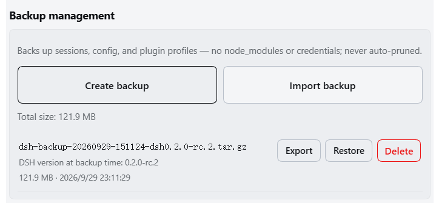


- Creates `.tar.gz` archives of sessions, configuration, and plugin-profile manifests; sessions are snapshotted through the persistence layer's stable-read seam (active-agent writes no longer fail creation), and creation shows one continuous phase progress bar (copy / pack / verify / publish, step counter 1/4–4/4, real percentage during copy)
- **DSH version at backup time**: the archive filename carries the DSH version running when the backup was taken (`dsh-backup-YYYYMMDD-HHmmss-dsh0.1.7-rc.1.tar.gz`), and `meta/backup.json` inside the archive records the DSH version, plugin version, and creation time; both the panel row and the restore preflight show it, so you can tell which version a snapshot came from (restoring across a downgrade cannot read newer session formats). Archives written by older plugin versions have no version segment: they still list and restore normally, they simply show no version line, and import accepts filenames both with and without the segment
- Export download / import upload / delete (two-step confirmation); unlimited, never auto-pruned; imported archives must pass the same integrity inspection used by restore
- **Integrity inspection** validates gzip/tar structure, paths, and entry types. Only `sessions`, the three allowlisted config files, `profiles/<name>/package.json`, and `meta/backup.json` are accepted; traversal, links, special files, unknown content, corrupt archives, and invalid profile manifests are rejected
- **Restore preflight** produces a single-use five-minute plan showing the full sessions replacement, config replacements/removals, and profile-manifest updates. Final commit rechecks the archive SHA-256 and current-target fingerprint; any drift rejects the restore
- **Cross-device / cross-platform restore**: every path inside an archive is relative and restore lands under the local `$DSH_HOME`, so a different DSH_HOME, username, or mount point makes no difference to import; `meta/backup.json` also records the source platform and architecture, and the preflight reports when the source system differs from the current one. The preflight additionally lists read-only notices (they never block a restore): paths past the classic Windows limit, paths differing only by case collapsing on this volume, and a sessions directory that is currently unwritable (in use or lacking permissions)
- **Target profile selection**: you choose which local profile the archive's `profiles/<name>` content restores into — candidates come from the profiles that actually exist here (the active one is marked), or you can keep the source name. A cross-name mapping does **not** overwrite the local profile's plugin manifest (`package.json`) by default; tick the box to overwrite it explicitly. The Profile configuration layer (`cordis.patch.yml`) is restored whenever the archive carries it
- Restore uses a transaction journal and rollback directory: sessions are replaced in full, config is made exact to the snapshot, and profiles update according to that mapping while keeping node_modules, credentials, and attachments. Managed runtimes restart automatically; manual launches receive hand-restart instructions. On Windows, a target left in use by another process fails with explicit guidance (quit the desktop app, pause sync clients, disable real-time antivirus scanning, then retry)

### Skills management

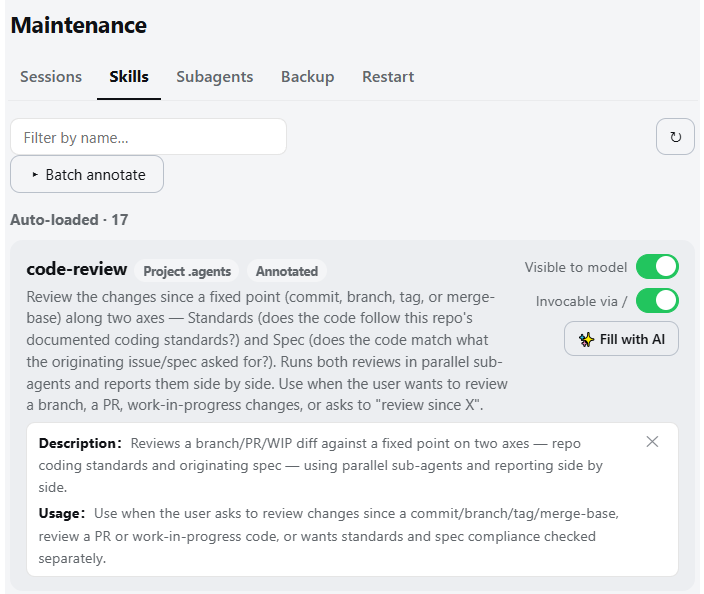

- Lists local skills in three sections — **auto-loaded / manual-only / fully disabled**; same-name shadowing marks both copies, bundled directories are read-only
- Two switches edit the SKILL.md frontmatter directly (`disable-model-invocation` / `user-invocable`); changes go live within ~200 ms
- Entries with legacy camelCase keys are dropped by the official parser: ⚠ warning + one-click canonical fix
- ✨ Fill with AI: pick a model to draft a description (follows the UI language), saved to a plugin sidecar index — **SKILL.md is never modified**; one-click batch fill runs in the host background and can be cancelled. Already-annotated skills are listed separately in the plan and are only overwritten after a "Confirm forced refill" second confirmation (annotating no longer blocks future batch fills forever); completion-log timestamps use your local timezone

### Model configuration

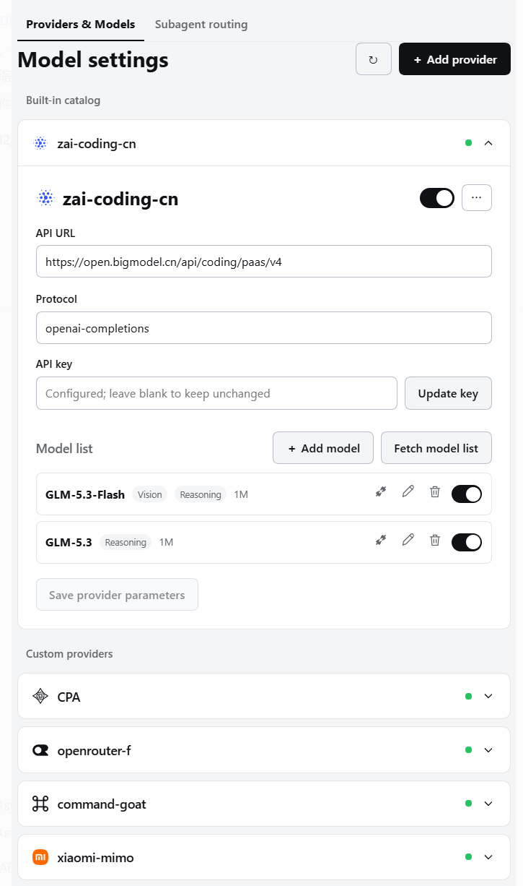

- Model configuration contains **Providers & models** and **Subagent routing**, separating built-in and custom providers.
- **Add custom providers** with an ID, display name, protocol, address, API key and model IDs. Creation never probes the endpoint automatically.
- **Mixed-protocol notice**: when a catalog mixes protocols (such as pi-ai's `azure` since 0.2.1-alpha.3), the template picker and provider editor explain that a route-level protocol overrides every model on the route, preventing Chat Completions models from being pinned to the Responses protocol.
- **Provider editing** covers display name, address and credentials. Custom protocols are editable; built-in protocols are read-only. The ordinary interface does not expose advanced provider parameters; unshown headers, timeouts and cache settings remain untouched — use the native DSH model settings to change them.
- **Model discovery** supports manual IDs or explicit Fetch online, with search and batch selection for OpenAI-compatible and Anthropic model lists. Discovery failure never blocks manual entry; a returned list does not prove calls work. "Select all" only adds currently visible candidates; selections outside the current list are counted separately and can be removed in one action.
- **Model editing** covers ID, display name, context window, max output, image input and reasoning levels. Capacity accepts `256K` / `1M`. Reasoning levels are a single click; **wire value mappings live in a collapsed "Wire value mapping (advanced)" section** — checking a level prefills its own name and the actual protocol value can be corrected after expanding — with distinct states for inherited/undeclared, explicitly unsupported and custom mappings. IDs must be unique per provider, and disabled models must be enabled before renaming.
- **Immediate toggles** block new main-chat and subagent calls while retaining configuration and keys; running calls are not cancelled. **When a provider is referenced by the default model or subagents, disabling first lists the affected references for confirmation**; unreferenced providers still disable in one click, and enabling is always immediate. Unloading the plugin removes this policy.
- **Basic call tests may incur charges**. Every test first shows the fixed content, token ceiling, timeout and billing notice, and only calls after confirmation. Tests use saved models and report elapsed time and sanitized errors; they do not verify images, capacity or every reasoning level, and failures never roll back configuration.
- **Smart fill starts disabled**. It queries local pi-ai, modelparams.dev and OpenRouter metadata by model ID, without provider discovery, inference or automatic saving. Suggestions are per parameter; confirming Fill all changes only the draft and still requires Save.
- **Check reasoning levels against the API**: selectable levels differ from the effort selected for a call. Missing metadata does not mean unsupported; unconfigured values inherit or use API defaults. Manually supplied mappings require verification.
- **Deletion checks references** to the main-chat default, subagent primary and fallback models, blocking deletion when referenced. A custom provider cannot lose its final model.
- **Restore and credentials**: provider deletion snapshots configuration and keeps credential references. Restore recovers configuration, never old key values. Recently deleted records can be removed individually after confirmation; removing a record prevents restoration from it but does not affect existing providers or credentials. Replacement defaults to an independent reference; shared replacement first lists users.
- **Draft and concurrency protection**: failed saves retain drafts; after a dropped connection or host restart the action resets so it can be retried, leaving unsaved edits warns, and external changes prevent overwrite until reviewed again. Drafts do not persist across reloads.

#### URL and credential safety

- Hosts without trackable configuration revisions remain view-only and refuse writes; configuration changes retain official DSH validation and atomic saving.
- Entering or saving an address never fetches it. Discovery uses the saved current-Profile address and requires public HTTPS on port 443, rejecting private addresses, IP literals and redirects, with timeout / size limits. Local or HTTP providers can still be saved with manual IDs.
- Keys pass over loopback into the DSH credential store, never echoed, logged or snapshotted. They go only to the corresponding provider, never metadata sites.

### Subagent model

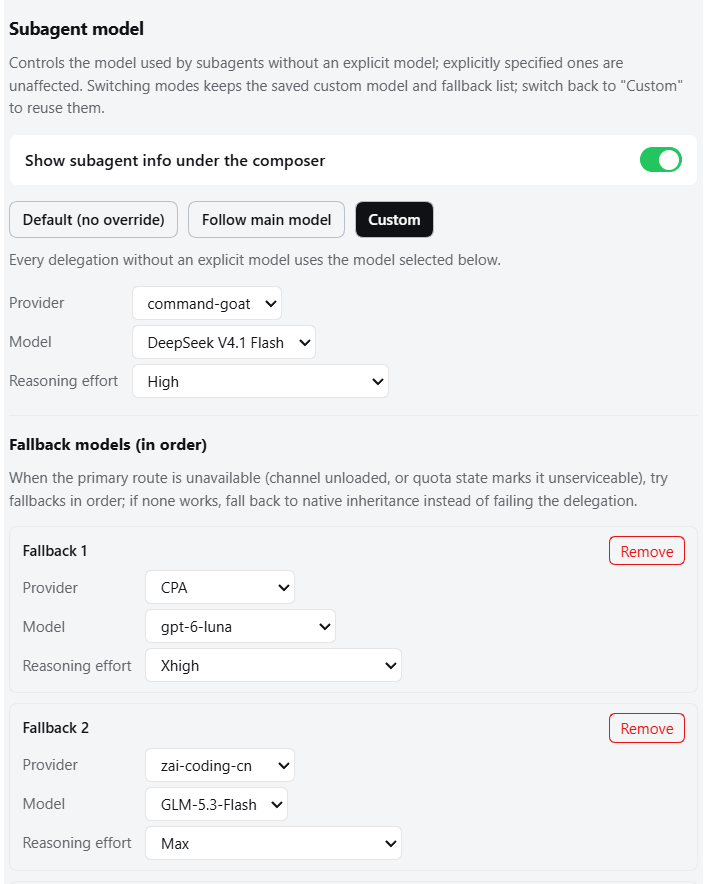

- Three modes: **Default** (no override), **Follow main model** (the latest model actually used by the main chat), and **Custom**. Entry: Model configuration → Subagent routing.
- Explicit provider/model values in a delegation always take priority.
- Custom models with declared reasoning levels offer an effort selection; blank uses the target default. Models without declarations explain that selection is unavailable.
- **Mode switching preserves configuration**: custom model, effort and fallback list remain saved when switching away and back.
- **Ordered fallbacks** in Follow and Custom modes handle unavailable channels or quota. If all routes are unavailable, use native inheritance.
- **Independent Agent preset** (0.2.1-alpha.3+ hosts): give every spawned subagent one independent preset (role and tools together); leave empty to follow the parent, explicit presets win, and only backends that support independent presets are affected.
- An optional composer line shows the models actually used by the session's subagents, including fallback and explicit routes. Records survive page reloads, not process restarts.
- Configuration lives at `$DSH_HOME/dsh-service-subagent-route.json`, with one-click reset.

### Task notifications

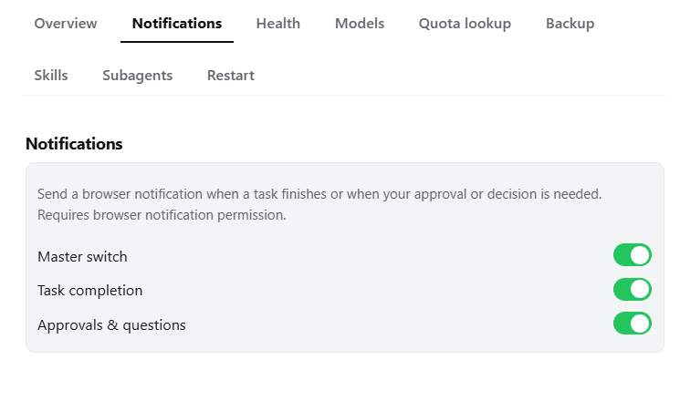

- Browser notification when a root session finishes its turn or any session needs approval / plan review / an answer; subagent completion is silent; clicking focuses the page
- Subagent approval / plan-review / question requests still notify
- Four independent toggles: master, task completion, approvals & questions, composer-bell visibility
- The composer bell toggles the master switch quickly; all toggles persist across reloads

### Mobile adaptation

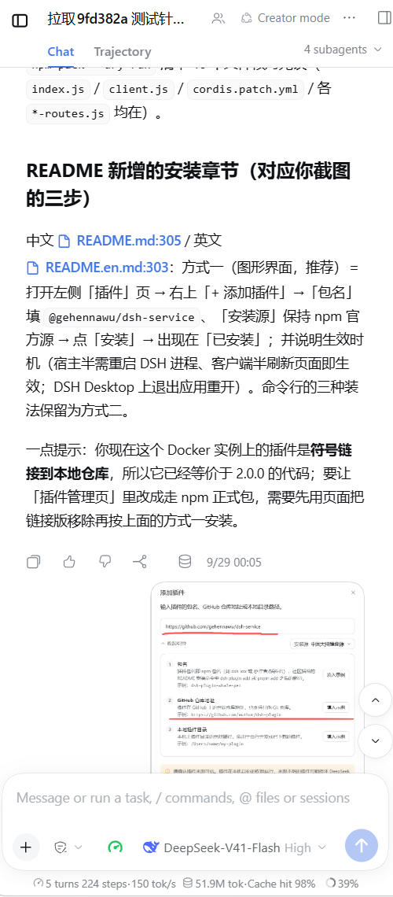

- Off by default; enabled behavior applies only below a 1024px viewport, leaving desktop unaffected.
- Supports sidebar drawers, narrow-screen settings navigation and full-screen panels, with model selection, task menus and Agent Team dialogs adapted for phones.
- **Scroll immersion** hides the header and composer when scrolling down; scroll up, go to bottom or focus the composer to restore them. Streaming updates never trigger it.
- **Drawer gestures**: swipe right to open the sidebar, left to open the right sidebar, and reverse to close. Editor horizontal scrolling is unaffected.
- An up-arrow jumps through previous user messages, automatically loading earlier history as needed.
- Large conversation JSON responses are compressed, with safe-area and mobile input zoom handling.

### Sidebar settings entry

- A persistent **Settings** row sits at the sidebar foot, directly **above the account button**: one click opens the official settings panel — no need to open the account menu first.
- It stays visible whether signed in or signed out; the official “Settings” item in the account menu is untouched, so both routes work.
- Collapsed into the icon rail, the entry becomes a 36×36 gear button whose tooltip and accessible name stay “Settings”.
- Its copy follows the interface language; on hosts without the seat the row simply does not appear and nothing else changes.

### Session manager

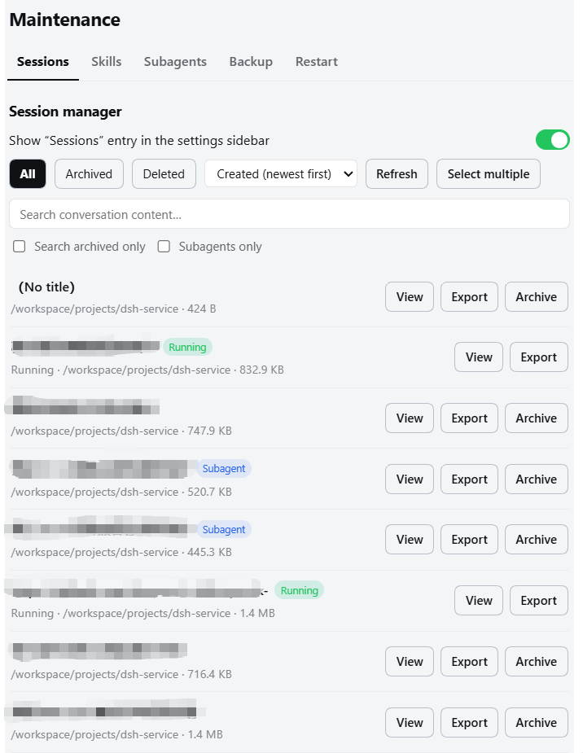

- **Browse** running, cold and archived sessions with workspace, event count and size. Sort by time / title or group by project; Archived is the default view.
- **Details** offer paged Markdown transcripts and collapsible system / tool events; returning preserves list scroll position.
- **Subagents** can be filtered or selected in bulk; plain forks are not misclassified as subagents.
- **Export** complete official ZIPs individually or in batches, including subagents and attachments.
- **Archive and unarchive** non-running sessions individually or in batches; unarchiving requires DSH ≥0.1.6, with older hosts remaining archive-only.
- **Content search** spans sessions with case-insensitive, whitespace-flexible matching; optionally restrict to archived sessions, jump into match context and navigate previous / next hits.
- **Delete**: Only archived sessions can be deleted. Running sessions are checked again and refused; two-step confirmation lists ID, title, workspace and size, then updates the official sidebar.
- **Deleted records** can be viewed and cleared individually or in bulk. They contain title / time only, no transcript, and cannot restore a session.
- Entry: Maintenance → Sessions; the optional settings-sidebar shortcut is off by default.

### Model provider icons

- Provider marks appear in model buttons, model lists and quota cards; unknown providers retain the official default icon.
- Covers common built-in pi-ai providers plus Ollama, vLLM, LM Studio, Perplexity, Cohere, Volcengine, Doubao, Hunyuan, StepFun, Cline and others.
- Custom names are recognized by prefixes / aliases such as `openrouter-f`, `zai-coding-cn`, `command-goat` and `cline-official`.
- Unknown names can use the adapter type **manually chosen** on the quota page. Name matches take priority; CLIProxyAPI icons require manual adaptation.
- Icons are bundled, work offline and never send provider names to third parties. Toggle under Plugin configuration → Interaction, on by default.
- Sources: [LobeHub Icons](https://github.com/lobehub/lobe-icons) (MIT) and [Simple Icons](https://github.com/simple-icons/simple-icons) (CC0). Brand marks belong to their owners.
- Relay gateways such as WorkBuddy2API have no brand assets of their own; their icon is the official mark of the upstream WorkBuddy product (the vector favicon of `workbuddy.cn`, bundled locally). Channel names `workbuddy2api-panel` / `workbuddy2api` / `workbuddy` all match.
- See the [icon catalog](docs/model-icons.html) for all marks and provider matching rules.

### Right-Sidebar file editing

- The official right-Sidebar preview header gains an **“Edit” button in its top-right corner** (next to the renderer name): one click enters editing — a monospaced editor with a dirty marker, `Ctrl/Cmd + S` saving, “Reload”, “Undo save”, and a one-click “Preview” back to the official renderer
- Two equivalent extra routes: the original **renderer dropdown**, and **right-click the tab → ⋯ menu → “Edit”** (the latter uses an official menu seat with no DOM injection at all, as the fallback if the header button ever stops working); while the editor tier is active the header button retracts itself
- **The official renderers keep their default status**: suffixes they own (`.md`, `.js`, …) still open as Markdown / code previews; only suffixes with no official renderer — the ones that used to fall back to plain text, such as `.txt`, `.log`, `.conf` — default to the editor. When the official preview is absent (older DSH), the whole block stays silent
- **Writes go through the session's own file service and sandbox policy**: the browser only sends a `dsh-resource://file/session/<session>/<path>` resource address, and the host resolves the session and workspace root itself — free-form paths are refused. Saving carries the version read earlier, so **a file changed by an Agent or another window is never overwritten silently**; you choose “Reload (discard edits)” or “Overwrite with mine”. Read-only sandbox sessions stay preview-only
- **Keep typing while saving**: a save response acknowledges only the submitted text; any newer typing stays in the editor as unsaved changes. The status distinguishes saving, unsaved changes, and saved. You can keep editing after a conflict, and overwrite uses the latest draft shown in the editor
- **Protect drafts before leaving**: the editor's own “Preview” and “Reload” buttons show an inline confirmation when changes are unsaved, with a cancel action to keep editing. “Undo save” also requires confirmation and retains its version guard rather than silently overwriting newer disk changes
- One 2 MiB cap per file (larger files are read-only); editing is unavailable when the session is inactive or the sandbox policy service is missing (the official preview remains available)
- Not in this first version: syntax highlighting, multi-cursor, find/replace (the plugin half has no bundler to borrow an editor component), and no unsaved-changes prompt when a tab closes
- The switch lives under Plugins → Plugin configuration → Interaction (on by default, live)

### External liveness probe

- `GET` / `HEAD /healthz` returns an empty 200; other methods return 405
- Suitable for Uptime Kuma, Docker, Kubernetes, and other external monitors

## 🏗️ Architecture

The plugin is a Cordis two-half structure: the **Host half (`index.js`)** owns all capabilities and data access, while the **Client half (`client.js`)** only renders UI in the browser; the two sides communicate over Typert JSON-RPC on a single-layer absolute path channel `/dsh-service`, with `loopback` authority throughout.

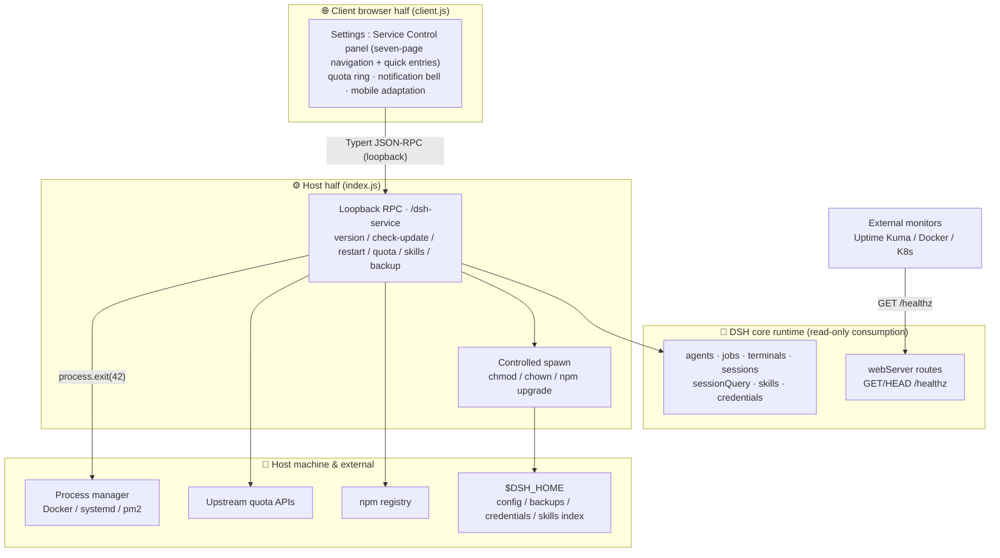

Key contracts:

- **Loopback only**: capabilities are exposed solely through the `/dsh-service` loopback channel; webServer routes return only information-free status codes
- **Restart = `process.exit(42)`**: the plugin only sends an exit signal; an external process manager brings it back — no manager, no restart guarantee
- **Zero input concatenation**: the browser side never supplies URLs, package names, commands, or paths; all commands go through a host-side whitelist
- **Credentials never leave the host**: API keys are resolved only inside the host process; the browser receives only normalized window data

## ⚡ Installation

### Option 1: DSH plugin manager (graphical, recommended)

1. Open the **Plugins** page in the left sidebar.
2. Click the **+ Add plugin** button in the top-right corner.
3. In the dialog, fill in **one of the three** source forms (the same field accepts all three, and the hint below it follows what you type):
   - **npm package name (recommended)**: `@gehennawu/dsh-service@2.1.1` — **include the exact version** (written as `package@version`);
   - **GitHub repository URL**: `https://github.com/gehennawu/dsh-service` (public repository, no token needed; the shorthand `github:gehennawu/dsh-service` works too);
   - **Local plugin directory**: an absolute path on this machine, e.g. `/path/to/dsh-service` (for your own or pre-downloaded plugins).
4. Pick the **install source** for your network: the default **official npm registry**, or the **China mainland mirror** if fetching from npm is restricted there (it affects package-name installs only; GitHub URLs and local directories are unaffected).
5. Click **Install** and wait for the official layer to add the package to the current profile (the dialog reports progress and the result).
6. The plugin then appears under **Installed**. The host half takes effect after the DSH process restarts; the client half applies on a page refresh.
   - On Web: use this plugin's **Service Control → Restart**, or send `/restart` in a conversation;
   - On DSH Desktop: quit the app and open it again (the desktop app owns the host process, so this plugin never exits it on its own).

> Tip: all three forms go through the official installation path — no manual profile edits; entering a GitHub URL in the dialog is equivalent to the `github:` prefix on the command line.

> **Why the npm form wants a version**: pnpm 11 enables a supply-chain release cooldown by default (`minimumReleaseAge`, 1440 minutes). **Without a version** (including `@latest`), a release published less than the cooldown period ago is not installed automatically, so the package manager falls back to the newest version that has cleared it — which is why the plugin page may report that it installed x.y.z instead of the latest a.b.c. Writing an **exact version** (e.g. `@gehennawu/dsh-service@2.1.1`) installs exactly the release you name. The cooldown is a supply-chain safety policy, not a sign that the new release is broken; if you are not in a hurry, installing without a version after the 24 hours have passed also reaches the new release.

### Option 2: Command line

| Method | Command |
| --- | --- |
| npm (recommended) | `dsh plugin --profile web add @gehennawu/dsh-service@2.1.1` |
| GitHub | `dsh plugin --profile web add github:gehennawu/dsh-service` |
| Local development | `dsh plugin --profile web add link:/path/to/dsh-service` |

The command line uses the default npm / pnpm registry; if you need a mirror, point npm / pnpm's registry at one the usual way first, then run the command above. The npm method is subject to the same pnpm release cooldown: without a version it installs the newest release that has cleared the cooldown, while an exact version (`@gehennawu/dsh-service@2.1.1`) installs that release (see the note under Option 1).

Restart DSH Web after installing or updating:

```sh
dsh web
```

Open DSH Web Settings and select **Service Control**.

## 🔄 Automatic restart

The plugin only sends an exit signal; it does not start the process again. Without a process manager, restart stops DSH Web.

The plugin passively detects a process manager (environment variables, `/.dockerenv`, `/proc/1/cgroup`, terminal TTY): with Docker/systemd/pm2/supervisord/Kubernetes detected it restarts as usual; when nothing is detected and stdin/stdout are an interactive terminal, it treats the launch as manual — flagged in Health diagnostics and switching one-click upgrade to keep running with manual-restart instructions. Heuristics cannot cover redirected output or wrappers such as NSSM/WinSW; declare `DSH_SERVICE_RUNTIME_ENV=managed|manual|desktop` explicitly.

### Docker Compose

```yaml
services:
  dsh:
    restart: unless-stopped
```

### systemd

```ini
[Service]
ExecStart=/usr/local/bin/dsh web --host 127.0.0.1
Restart=on-failure
RestartSec=2
```

### pm2

```sh
pm2 start "dsh web --host 127.0.0.1" --name dsh-web
```

## 🖥️ Platform support

| Environment | Plugin features | Automatic recovery | Verification |
| --- | --- | --- | --- |
| Linux + Docker Compose | Supported | Supported with a restart policy | Verified |
| Linux + systemd / pm2 | Expected to work | Managed externally | Not separately tested |
| macOS / Windows + pm2 or similar | Not blocked by the code | Managed externally | Not tested |
| DSH Desktop (Windows, Electron) | Supported | Owned by the desktop app | Verified (real host, 2026-09-28) |
| DSH Desktop (macOS / Linux, Electron) | Not blocked by the code | Owned by the desktop app | Not verified |
| Direct `dsh web` execution | Supported | Not supported | Expected behavior |

Requirements: Node.js `>=22`, and a DSH Web installation capable of loading both Host and Client plugin halves. Update checks require access to `registry.npmjs.org`; network failures do not affect other features.

**DSH compatibility**: `>=0.1.1-rc.2` (**no upper bound**), verified through `0.2.1-rc.3`. Why no upper bound: since `0.2.1-alpha.4` the host gates plugin compatibility on a declared `engines.dsh` alone, so any pinned ceiling blocks the whole plugin on each new DSH release (**and the plugin's own one-click upgrade is blocked by that same gate, leaving no self-recovery path**). An open range keeps the plugin loading on newer versions; individual features may lag, but nothing breaks and no release is needed just to move the ceiling. Older DSH cannot read newer session formats; **backups cannot be restored across a downgrade**.


**DSH Desktop**: restart and post-restore restart require quitting and reopening the app; upgrade through its own plugin manager. Notifications require system permission, and clicking one may not restore a hidden window—use the tray. Other platforms are best-effort, without compatibility guarantees.

## 🔒 Security design

| Area | Boundary |
| --- | --- |
| Input | The browser cannot supply URLs, package names, commands, or file paths. **One exception**: right-Sidebar file editing accepts only a `dsh-resource://file/session/<session>/<path>` resource address (decoded per segment; every other shape is refused); the session and workspace root are always resolved host-side, and writes are fenced by the session's sandbox policy |
| Network | Update checks only access fixed npm registry endpoints |
| RPC | Loopback-only; data never leaves the machine |
| Data | The usage index stores no messages, prompts, tool arguments, or credentials; API keys are used inside the host process only |
| Actions | Destructive operations (restart, delete, permission repair) all require two-step confirmation |
| Credentials | Stored in the DSH credential store (`$DSH_HOME/.credentials.yaml`), sent to fixed endpoints only |

## ❓ FAQ

<details>
<summary><strong>It does not come back after restart?</strong></summary>

The plugin only sends an exit signal; a process manager brings it back (see "Automatic restart"). When the panel flags a manual launch, a plain `dsh web` terminal process exits for good — run it under Docker Compose / systemd / pm2 instead.
</details>

<details>
<summary><strong>What is the yellow "no restart assurance" caution in Health?</strong></summary>

It is the "likely manual terminal launch" detection — no process manager found. If it is actually managed by NSSM/WinSW or output redirection, declare `DSH_SERVICE_RUNTIME_ENV=managed` to clear it.
</details>

<details>
<summary><strong>Why do task notifications not appear on DSH Desktop?</strong></summary>

Check two things first: (1) the **master notification switch** under "Configuration → Notifications" must actually be on — it defaults to off and only turns on after you click "Enable notifications" and the system grants permission (if you only see the "Enable notifications" button, permission has not been granted yet); (2) the session must really go from running to finished, and it must not be a subagent session. System notifications themselves do work on the desktop app: Windows "Settings → System → Notifications" registers an `electron.app.DeepSeek Harness` entry, and a real "task complete" toast has been observed on the actual machine. The only known boundary is that **clicking the notification does not bring the window back** — closing the window hides it and the current desktop bridge exposes no window API; use the system tray instead.
</details>

<details>
<summary><strong>A quota card shows "credential missing"?</strong></summary>

Use the inline form on the card: an API key for regular adaptations, the management key for CLIProxyAPI (not the proxy key), and the console cookie for Xiaomi Token Plan. The value goes into the DSH credential store and the provider refreshes automatically; if a process environment variable shadows the name, the host refuses the write — change the variable itself. To fix a typo or rotate a key, a configured card keeps an "Edit credential (configured)" entry in its **Config** area where the stored value can be overwritten or cleared.
</details>

<details>
<summary><strong>A CLIProxyAPI card shows "Temporarily banned by CLIProxyAPI"?</strong></summary>

Repeated wrong management keys tripped the CPA fail2ban: five failures from one IP ban that IP for 30 minutes, and while banned **even the correct key is rejected**. That state deliberately offers no credential form (the key itself is fine). Wait for the ban to expire (the upstream message carries the remaining time), or change the DSH host's egress IP, then hit "Retry connection". The ban applies to the `/v0/management` plane only — model inference through that CPA keeps working.
</details>

<details>
<summary><strong>Command Code shows "credential rejected by upstream"?</strong></summary>

The inference and quota planes share one key (`user_*` prefix, created in Studio's API keys page). This error means the upstream rejected the key: regenerate or copy it in Studio at commandcode.ai, then paste it via "Set API credential". If the channel's baseURL points at a self-hosted relay rather than `api.commandcode.ai`, note the quota plane always queries the official account plane — a relay key cannot read official quota.
</details>

<details>
<summary><strong>Xiaomi shows "credential rejected by upstream"?</strong></summary>

The web session expired. Log back in at platform.xiaomimimo.com, copy the `Cookie:` header from any `/api/v1/tokenPlan/` request, and paste it again via "Set console cookie".
</details>

<details>
<summary><strong>StepFun Step Plan card shows "credential missing"?</strong></summary>

Step Plan has no API-key query endpoint — it needs a web session token. Log in at platform.stepfun.com, press F12 → Application → Cookies → platform.stepfun.com, copy the full `Oasis-Token` value (shaped like `xxx...yyy`; the two-dot separator is part of the token format, do not split it), then paste it via "Set console token (Oasis-Token, browser session)". The `Oasis-Webid` is derived from the token automatically.
</details>

<details>
<summary><strong>StepFun Step Plan card shows "credential rejected by upstream"?</strong></summary>

The token expired (the official `oasis-token is embezzled` error means the token and web_id no longer match). Log back in at platform.stepfun.com, copy the full new `Oasis-Token` from Cookies and paste it again; if the copied value carries an `Oasis-Token=` or `Cookie: ` prefix it is stripped automatically.
</details>

<details>
<summary><strong>What does restoring a backup do?</strong></summary>

The host first runs an integrity inspection and presents a restore-preflight plan for final confirmation. Immediately before commit it rechecks the backup SHA-256, current-target fingerprint, and running work; any change aborts without a partial overwrite or restart. A successful commit replaces sessions in full, makes the allowlisted config files exact to the snapshot, and updates profiles exactly as the preflight mapping says (a cross-name mapping restores only the Profile configuration layer unless you tick the manifest box; node_modules, credentials, and attachments stay untouched). Docker/systemd/pm2-style managed runtimes restart automatically; likely terminal-launched instances show manual-restart instructions. Deleting a backup also requires two-step confirmation.
</details>

<details>
<summary><strong>Why is a skill switch greyed out?</strong></summary>

That skill lives in a read-only bundled directory. Only `project-*` and `user-*` sources support the two-way switches.
</details>

<details>
<summary><strong>Saving a skill switch says "the skill file just changed"?</strong></summary>

Concurrency protection kicked in: SKILL.md was just modified by an external editor (version mismatch). Refresh to get the latest state and retry.
</details>

<details>
<summary><strong>The plugin page installed the plugin, but the version is an older one?</strong></summary>

pnpm 11 enables a supply-chain release cooldown by default (`minimumReleaseAge`, 1440 minutes): **installing without a version** (including `@latest`) only selects the newest release that has already cleared the cooldown, so a freshly published release is skipped and the official plugin page reports that it installed x.y.z instead of the latest a.b.c. To get the new version right away: uninstall it in the plugin page and reinstall with `package@version` (e.g. `@gehennawu/dsh-service@2.1.1`), or use this plugin's **Service Control → Upgrade** — it installs an exact version and is not subject to the cooldown. The cooldown is a supply-chain policy (a fresh release may contain defects that are not known yet); after the 24 hours have passed, installing without a version also reaches the new release.
</details>

<details>
<summary><strong>Does a failed update check affect other features?</strong></summary>

No. It is a read-only request to the npm registry and fails silently; everything else keeps working.
</details>

## 🤝 Contributing

Issues and pull requests are welcome. See AGENTS.md in the repository for the development roadmap and conventions, and its "Release" section for publishing rules.

## 📄 License

[MIT](./LICENSE)