<div align="center">

[English](./README.en.md)

# 🛠️ dsh-service

<p align="center">
  <strong>DeepSeek Harness (DSH) Web 服务控制与运维插件</strong><br>
  <em>A service-control &amp; operations plugin for DeepSeek Harness (DSH) Web.</em>
</p>

[](package.json)
[](LICENSE)
[](https://github.com/deepseek-ai/deepseek-harness)
[](https://cordis.moe/)
[](https://github.com/gehennawu/dsh-service)
[](https://github.com/gehennawu/dsh-service/issues)
[](https://awesome-dsh-plugin.com)

<p align="center">
  <a href="#-功能">功能</a> •
  <a href="#-架构">架构</a> •
  <a href="#-安装">安装</a> •
  <a href="#-自动重启配置">自动重启配置</a> •
  <a href="#-平台支持">平台支持</a> •
  <a href="#-安全设计">安全设计</a> •
  <a href="#-常见问题-faq">常见问题 FAQ</a> •
  <a href="#-参与贡献">参与贡献</a> •
  <a href="#-许可证">许可证</a>
</p>

---

</div>

DSH Web 服务控制与运维插件：安全重启、版本管理与一键升级、健康诊断、模型用量统计、额度查询、备份管理、任务通知、技能管理、会话管理与 Linux 文件权限维护。

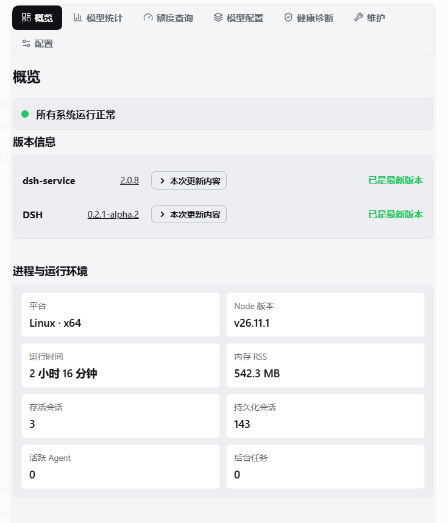

## 📑 目录

- [🚀 功能](#-功能)
  - [版本与更新](#版本与更新) · [安全重启](#安全重启) · [健康诊断](#健康诊断) · [模型统计](#模型统计)
  - [额度查询](#额度查询) · [模型配置](#模型配置) · [备份管理](#备份管理) · [技能管理](#技能管理) · [子代理模型](#子代理模型)
  - [任务通知](#任务通知) · [会话管理](#会话管理) · [移动端适配](#移动端适配) · [模型厂家图标](#模型厂家图标) · [右栏文件编辑](#右栏文件编辑) · [外部探活](#外部探活)
- [🏗️ 架构](#-架构)
- [⚡ 安装](#-安装) · [🔄 自动重启配置](#-自动重启配置) · [🖥️ 平台支持](#-平台支持)
- [🔒 安全设计](#-安全设计) · [❓ 常见问题 FAQ](#-常见问题-faq) · [🤝 参与贡献](#-参与贡献) · [📄 许可证](#-许可证)

## 🚀 功能

设置页「服务控制」面板七页导航：**概览 · 模型统计 · 额度查询 · 模型配置 · 健康诊断 · 维护 · 配置**；其中「模型配置」聚合渠道与模型 / 子代理路由，「维护」聚合 会话管理 · 技能 · 备份维护 · 重启 四个子页，「配置」聚合 功能开关 · 任务通知 · 设置栏标签 三个子页。重启、额度查询、会话管理可另行开启**设置页左列快捷入口**（默认关闭；技能与子代理的左列入口已撤销）。

「插件 → 插件配置」提供十三个宿主级开关：**健康诊断、模型统计、额度查询、模型配置、备份维护、任务通知、技能管理、子代理模型、会话管理、移动端适配、模型厂家图标、右栏文件编辑、`/healthz` 探活**（除移动端适配外默认开启）。全部热生效：关闭即隐藏界面、停止轮询并让宿主拒绝对应能力；概览与重启固定保留。

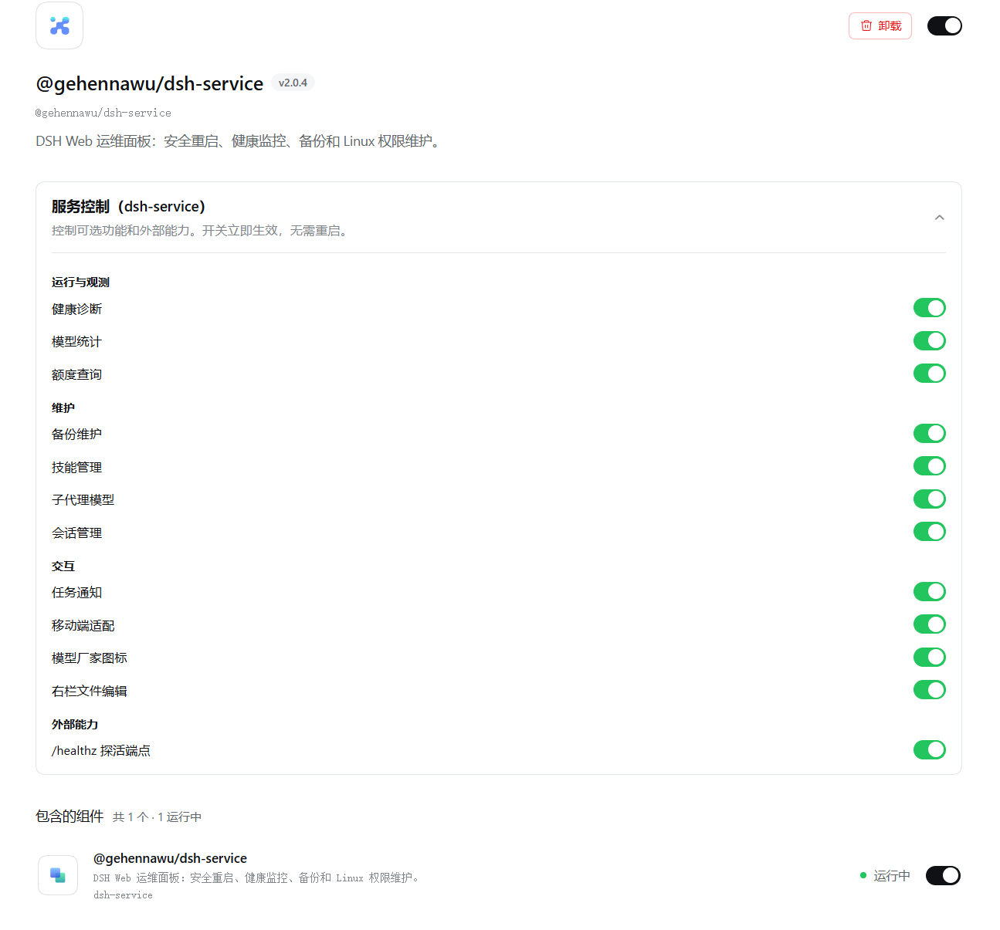

### 概览

- 查看服务状态、待处理问题、DSH / 插件版本、运行环境与近期报错。
- 健康诊断、备份、统计、额度等异常会汇总为提醒；可更新与尚无备份属于信息提示。

### 维护与配置聚合页

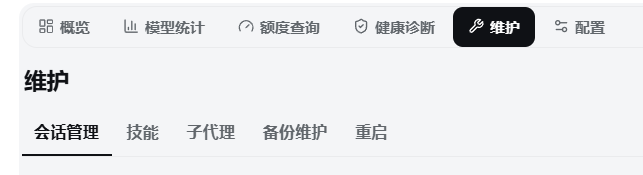

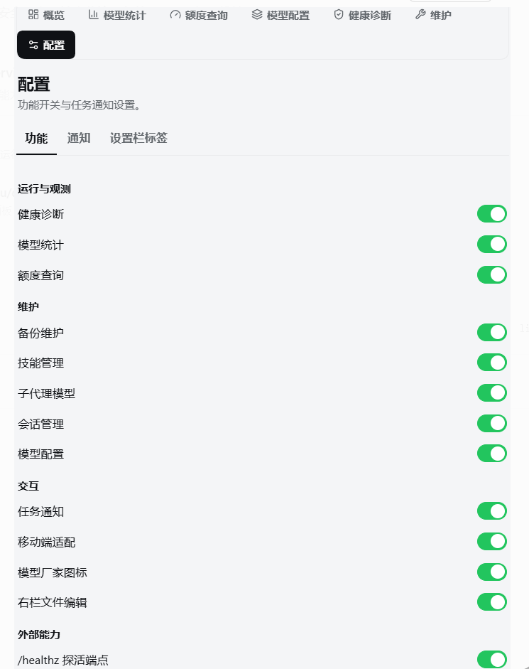

- 「维护」集中会话管理、技能、备份维护与重启，并记住最近使用的子页。
- 「配置」集中功能开关、任务通知与设置栏标签；支持拖拽 / 箭头排序和显隐管理，服务控制入口始终保留。
- 设置栏标签与额度卡片偏好支持多设备同步，保存在 `$DSH_HOME/dsh-service-config.json`；各功能配置互不影响。

### 版本与更新

- 显示当前 DSH 与插件版本，链接 GitHub Releases
- 自动检查 npm **正式版 + 预览版**（latest / next 双 tag）
- 「本次更新内容」查看当前版本更新说明；有新版时点击版本提示查看新版说明，支持就地阅读与 Esc 关闭。
- 一键升级，完成后自动重启；未检测到进程管理器时先确认后果，保持运行并提示手动重启
- 升级落地但进程尚未重启期间（手动启动环境尤为常见），版本行改示「已安装 X，重启后生效」并收起升级按钮，重开面板或刷新页面状态依旧；重启进程后恢复常态

### 安全重启

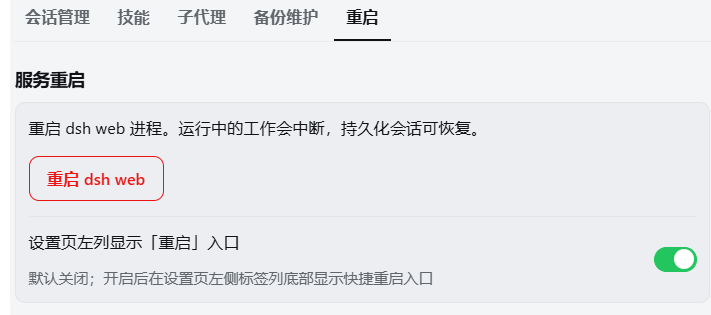

- 重启前检测活跃 Agent、后台任务与终端，展示清单并要求显式确认
- 对话输入 `/restart` 也可触发；检测到运行中工作时自动拒绝
- 重启后自动探测新进程并刷新页面，60 秒未恢复提供手动刷新；对话里用 `/restart` 触发的重启同样自动刷新（页面加载时记下进程身份，重连后比对 `instanceId`，新进程上线即刷新）
- 可开启「设置页左列显示入口」（默认关闭），与「维护 → 重启」子页共用同一确认流程
- 疑似终端手动启动时提示「退出后不会自动拉起」，健康诊断以黄色警示标注

### 健康诊断

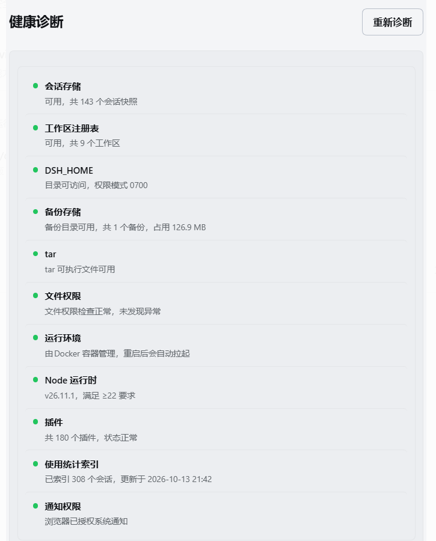

- 查看运行时间、内存、会话数、活跃 Agent、后台任务、平台、架构与 Node 版本。
- 检查会话存储、工作区注册表、备份目录、tar、文件权限、运行环境与使用统计索引。
- **使用统计索引**显示已索引 / 失败会话数与更新时间；部分读取失败不会阻止其他会话统计，关闭模型统计后不再检查此项。
- **通知权限**提示浏览器未授权或拒绝通知，并给出恢复入口；不影响概览状态，关闭任务通知后不再显示。
- **插件健康检查**列出失败或依赖未就绪的插件及错误；失败插件可确认后重新加载。手动停用不算异常，已释放或未知状态仅作信息提示。
- 「权限与修复」提供文件权限深检与两段式确认修复。
- 疑似手动启动时提示「重启无保障」；无备份仅作信息提示。

### 模型统计

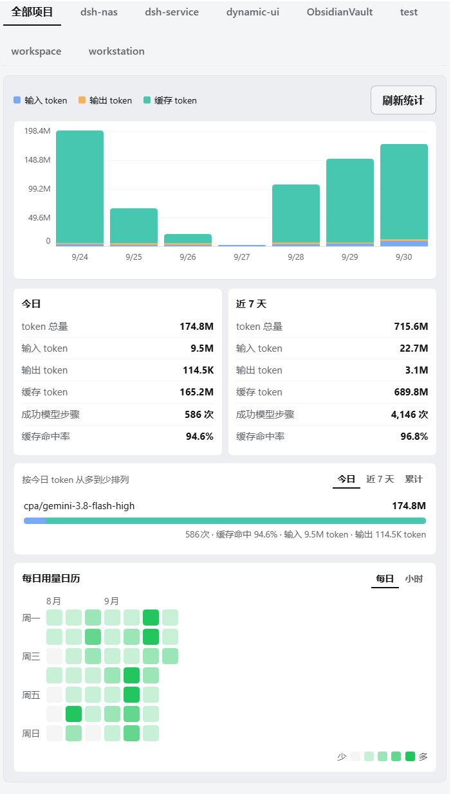

- 近 7 天输入 / 输出 / 缓存 token 趋势，按项目筛选；悬停查看 token 总量、成功模型步骤与缓存命中率。
- 模型明细可切换「今日 / 近 7 天 / 累计」。
- **日用量热力日历**覆盖最多 20 周，可切换为星期 × 小时分布，随项目筛选联动。
- **历史用量永久保留**：删除会话或项目不会扣减已统计用量；已删除项目从筛选中移除，但仍计入全部总量。
- 查看最近 48 小时模型 / 工具报错；无报错时不显示。
- 打开面板、进入统计页、跨本地零点或返回前台时自动同步，也可手动刷新；闲置时不周期轮询。
- 提供方未上报 token 的步骤不纳入统计。单会话读取失败时保留旧缓存、标明过期并重试，其他会话照常统计；可展开查看失败原因，新的失败会重新提示。

### 额度查询

- 供应商卡片保留既有窗口展示（标签+百分比 / 独立进度条 / 重置倒计时）；**配置**（凭据填写、类型切换、手动重置录入）默认折叠，按卡展开

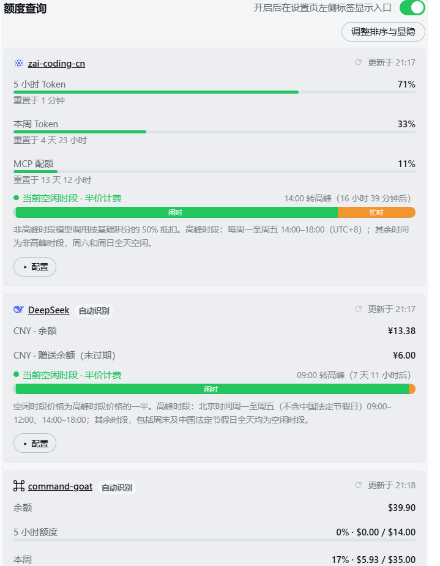

- 卡片分区展示各供应商：窗口百分比、独立进度条、重置时间；支持强制刷新与官网用量页链接
- 卡片**排序与显隐**：额度页「调整排序与显隐」展开管理列表，可拖拽或点 ↑↓ 调整卡片顺序，开关可隐藏不常用卡片（隐藏只影响展示，不影响查询）；配置与设置栏标签同源，写入服务端统一配置文件 `$DSH_HOME/dsh-service-config.json` 的 `quotaCards` 区块（多设备同步、本地缓存兜底，区块间互不影响）
- 对话输入框**额度圆环**：跟随当前会话模型所属供应商，显示最紧预算窗口用量（<80% 绿、≥80% 黄）；点击弹出详情面板，窄屏自动切换为居中浮层
- 内置适配：

| 供应商 | 数据来源 |
| --- | --- |
| DeepSeek 开放平台 | 官方余额 + 峰谷时段提示（忙/闲色带、换挡倒计时；高峰=周一至周五 09:00–12:00、14:00–18:00 UTC+8，**不含中国法定节假日**，周末与法定节假日全天空闲） |
| 智谱 GLM Coding Plan | 官方端点：5 小时滚动 / 每周 / MCP 月度三窗口 + 峰谷时段提示（忙/闲色带、换挡倒计时；高峰=周一至周五 14:00–18:00 UTC+8） |
| OpenCode Go | `{baseURL}/usage`（内置渠道未写 baseURL 时用注册表默认端点 `https://opencode.ai/zen/go/v1`） |
| OpenRouter | credits 已用百分比 |
| Kimi / 硅基流动 | 人民币余额 |
| Vercel AI Gateway | 官方 `GET /v1/credits` 查询团队剩余 USD 余额（Gateway API key；累计消费不作为套餐上限） |
| Poe | API key 查询剩余 points（非货币积分，不显示金额油表） |
| ClinePass | API key 查询 5 小时 / 每周 / 每月套餐用量及重置时间 |
| StepFun 余额 | 官方 `GET /v1/accounts`（API key，com/ai 双域） |
| StepFun Step Plan | 控制台 BFF 订阅额度（Oasis-Token 登录令牌；5 小时/周窗口与 Credit 月池自动识别） |
| 小米 MiMo Token Plan | 控制台同源套餐额度（网页登录态 Cookie） |
| Command Code（command-goat） | 官方账号额度面 `api.commandcode.ai/alpha/*`（同 key 复用：余额 + 本周期花费 + 套餐 + 5 小时/周窗口） |
| CLIProxyAPI 部署 | 各 OAuth 上游账号官方剩余额度 |

- 凭据写入 DSH 凭据库（`$DSH_HOME/.credentials.yaml`，热生效）：普通适配填 API key，CLIProxyAPI 填管理密钥，小米填控制台 Cookie，StepFun Step Plan 填控制台令牌（Oasis-Token，`Oasis-Webid` 由令牌自动派生无需手填）；Command Code 额度面与推理面同一把 key，无需另配
- **凭据可随时修改**：每张已适配卡片的「配置」区常驻凭据入口——未配置时显示各渠道的填写文案，已配置后显示「修改凭据（已配置）」，可直接覆盖（密钥轮换、换账号、填错想改）或清除已存值；凭据值只随保存请求发出，绝不回显
- 防风控：结果缓存 60 秒、瞬时网络错误指数退避（30 秒 ×2、封顶 15 分钟）；**确定性失败转手动**——凭据类、4xx、套餐失效、管理面未启用、响应格式异常等「换配置才可能恢复」的错误，宿主停止自动重试（错误行改报「自动重试已暂停，请手动重试」），只有点刷新手动重连（带 5 秒冷却）且成功后，才回到自动模式；查询为纯手动——打开额度页/展开圆环/点刷新才拉取，客户端不排任何周期轮询（上游节流仍全部在宿主侧）
- **CLIProxyAPI 管理面封禁有专属提示**：管理面对同一 IP 连续认证失败 5 次封 30 分钟，被封时卡片显示「已被 CLIProxyAPI 暂时封禁」+ 上游原话（含剩余时间）；该状态不提供重填密钥的入口（密钥没错），等封禁解除或更换出口 IP 后点「重试连接」即可；封禁只作用于管理面，走该 CPA 的模型推理不受影响
- CLIProxyAPI 某账号实时查询失败时，回退显示其上次缓存的快照窗口并标注「缓存」徽标；重置时间已过的快照窗口（快照描述的窗口已结束）直接丢弃，避免「额度停在昨天」的错觉
- 失败原因如实呈现：卡片与圆环显示「错误文案（HTTP 状态 · 失败端点 · 失败账号 · 上游原话）· 下次自动重试时刻」——错 key、欠费、限流、路径变更各有各的上游原话与状态码，不再只有一个笼统提示；上游 401/403 判为「凭据被上游拒绝」，卡片同时保留凭据填写入口；HTTP 200 业务信封里的错误码同样定族——鉴权失败判凭据被拒（保留填写入口）、套餐到期判无生效订阅、上游自身故障判「上游服务故障」，不再一律报「响应格式异常」；转手动模式的错误行末尾改报「自动重试已暂停，请手动重试」
- API key 只在宿主进程内解析，浏览器仅收到归一化窗口数据；未适配的供应商绝不发起请求

### 备份管理

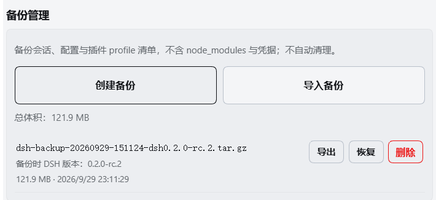


- 创建会话、配置与插件 profile 清单的 `.tar.gz` 归档；会话经持久化层稳定快照（活跃 agent 写入不再导致失败），创建过程以单条连续进度条分阶段显示（复制/打包/校验/发布，带步骤号 1/4–4/4，复制阶段为真实百分比）
- **备份时版本信息**：归档文件名带备份那一刻的 DSH 版本（`dsh-backup-YYYYMMDD-HHmmss-dsh0.1.7-rc.1.tar.gz`），归档内另有 `meta/backup.json` 记录 DSH 版本、插件版本与创建时刻；面板行内与恢复预检都显示该版本，便于判断这份快照出自哪个版本（跨版本降级恢复读不动新格式会话）。旧版本插件所出的归档没有版本段，列表照常显示、恢复照常进行，只是不显示版本行；导入同时接受带版本段与不带版本段两种文件名
- 导出下载 / 导入上传 / 删除（两段式确认）；不限份数、不自动清理；导入归档必须先通过与恢复相同的完整性检查
- **完整性检查**：恢复前校验 gzip/tar、路径与条目类型，只接受 `sessions`、三份允许配置、`profiles/<name>/package.json` 与 `meta/backup.json`；拒绝越界路径、链接、特殊文件、未知内容、损坏归档与非法 profile 清单
- **恢复预检**：先生成 5 分钟有效的一次性计划，展示会话整体替换、配置覆盖/移除和 profile manifest 覆盖清单；最终确认前再次校验归档 SHA-256 与当前目标指纹，发生漂移则拒绝执行
- **跨设备 / 跨平台恢复**：归档内的路径全部是相对的，恢复按**本机** `$DSH_HOME` 落地，所以 DSH_HOME、用户名、挂载点不同都不影响导入；`meta/backup.json` 另记录备份时的来源平台与架构，预检会提示来源与当前系统不同。预检同时列出只读提示（不阻断恢复）：路径超过 Windows 经典上限、仅大小写不同的路径在当前卷上会折叠、会话目录当前不可写（占用或权限不足）
- **目标 profile 选择**：归档里的 `profiles/<名>` 内容恢复进**本机哪个 profile** 由你选——候选来自本机实际存在的 profile（含当前活动 profile 标记），或保持与源同名；跨名映射默认**不覆盖**本机 profile 的插件清单 `package.json`，可显式勾选覆盖；Profile 配置层 `cordis.patch.yml` 归档有则照常恢复
- 恢复提交使用事务日志和回滚目录：会话整体替换，配置按快照精确替换，profile 按上述映射更新并保留 node_modules/凭据/附件；成功后托管环境自动重启，手动启动环境提示用户手动重启；Windows 上目标文件被占用导致失败时给出明确指引（退出桌面应用、暂停同步盘、关闭杀毒实时扫描后重试）

### 技能管理

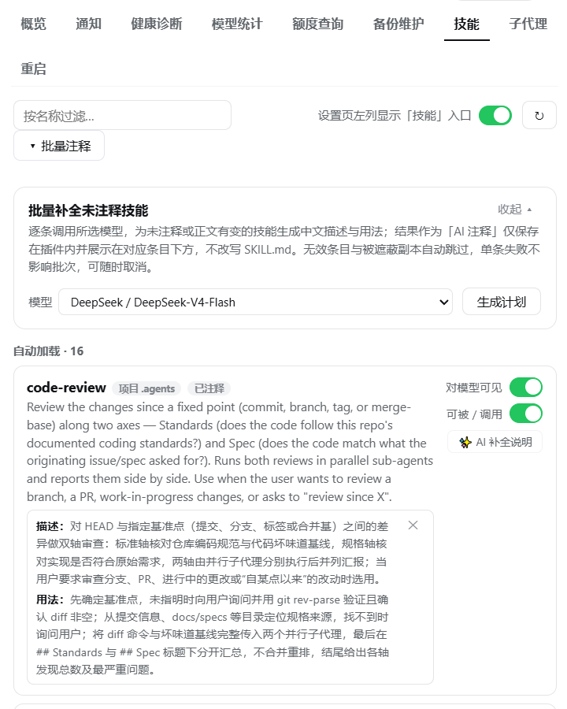

- 按 **自动加载 / 仅手动调用 / 完全停用** 三区展示本地技能；同名遮蔽与被遮蔽副本均有标注，内置目录只读
- 双开关直接改写 SKILL.md frontmatter（`disable-model-invocation` / `user-invocable`），约 200ms 热生效
- 带 camelCase 旧版键的条目会被官方解析器剔除：⚠ 提示 + 一键修复
- ✨ AI 补全说明：选模型生成描述草稿（跟随界面语言），确认后存入插件侧车索引——**绝不改写 SKILL.md**；支持一键批量补全（宿主后台运行、可取消）。已注释技能会在计划中单列，经「确认强制补全」二次确认后才会被覆盖（不再是一旦注释就永远无法再次补全）；补全日志时间按本机时区显示

### 模型配置

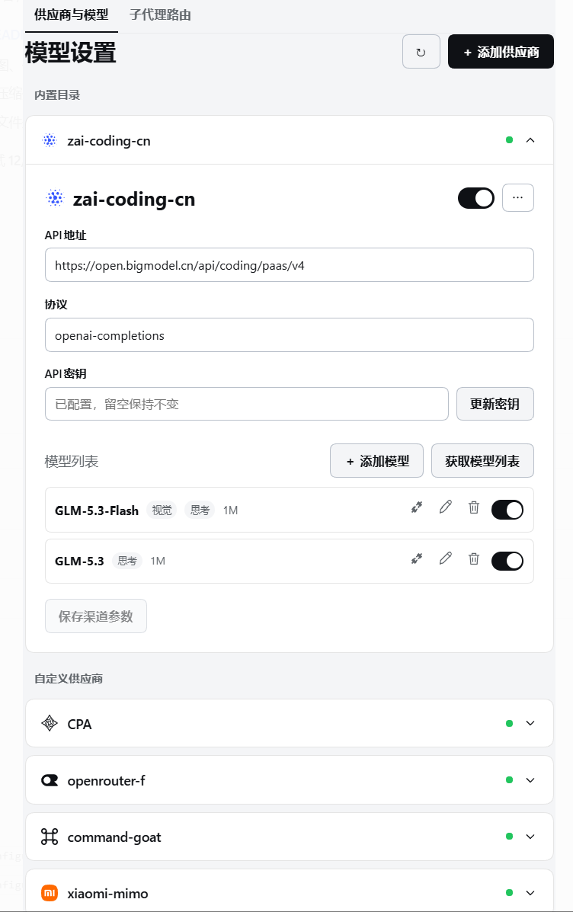

- 「模型配置」包含**渠道与模型**、**子代理路由**两个子页，区分内置与自定义渠道。
- **添加自定义渠道**：填写标识、显示名、协议、地址、API Key 与模型 ID；创建不会自动探测接口。
- **混合协议渠道提示**：渠道目录同时含多种协议（如 0.2.1-alpha.3 起 pi-ai 的 `azure`）时，模板选择与渠道编辑会提示「路由级协议覆盖该路由全部模型」，避免把 Chat Completions 模型钉到 Responses 协议。
- **渠道编辑**：修改显示名、地址与凭据；自定义渠道可修改协议，内置协议只读。未展示的 headers、超时、缓存与其他高级参数保留不变。
- **模型获取**：可手填 ID，也可点击「在线获取」搜索、勾选并批量添加；支持 OpenAI 兼容与 Anthropic 模型列表。获取失败不影响手动添加，拿到列表不等于调用成功。
- **模型编辑**：修改 ID、显示名、上下文窗口、最大输出、图片输入和思考等级；容量支持 `256K`、`1M`，留空继承目录默认值。同渠道 ID 不得重复，已停用模型需启用后改名。
- **即时启停**：停用后主对话与子代理不能发起新调用，配置和密钥保留，已运行请求不强行取消。该策略随插件卸载撤去。
- **基础调用测试可能计费**：使用已保存模型发送短文本，显示耗时和脱敏错误；只验证文本调用，不验证图片、容量或全部思考档位，失败不会回滚配置。
- **智能填充默认关闭**：开启后按模型 ID 查询本机 pi-ai、modelparams.dev 和 OpenRouter 资料；不探测渠道、不发推理、不自动保存。建议按参数展示，「一键填入」确认后只更新草稿，仍需保存。
- **思考等级需核对**：可选档位声明与调用时选择不同；缺少资料不等于不支持，未配置时沿用继承值或接口默认行为。手动填写的档位参数需与实际接口核对。
- **删除引用检查**：先列出主对话默认模型、子代理主模型和回退模型引用，存在引用则阻止删除；自定义渠道不能删到零模型。
- **恢复与凭据**：删除渠道前保存配置快照，删除保留凭据引用；可恢复配置，但不恢复旧密钥值。换密钥默认建立独立引用，替换共享凭据前列出使用者。
- **草稿与并发保护**：保存失败保留草稿，离开未保存编辑前提醒；配置发生外部变动时拒绝覆盖，重新核对后再保存。草稿不跨刷新保存。

#### URL 与密钥安全机制

- 旧宿主缺少可追踪配置 revision 时仅可查看，写操作明确拒绝；配置写入经过 DSH 官方校验与原子保存。
- 输入或保存地址不会自动出网；在线获取只使用当前 Profile 已保存地址，要求公网 HTTPS、443 端口，拒绝私网、IP 字面量与重定向，并限制超时和响应大小。本地 / HTTP 渠道仍可保存并手填模型。
- 密钥只经 loopback 保存到 DSH 凭据库，不回显、不写入日志或快照，只发往对应渠道，绝不发往资料站。

### 子代理模型

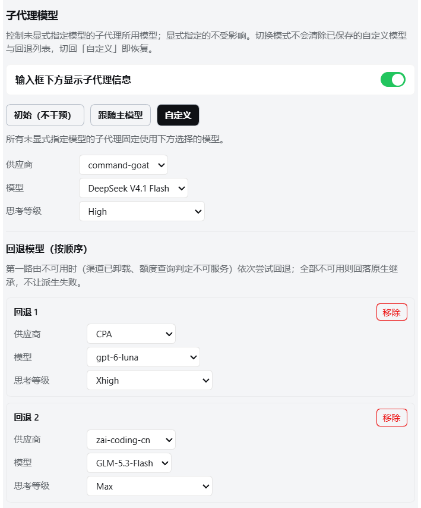

- 三种模式：**初始**（不干预）/ **跟随主模型**（主对话最近实际使用的模型）/ **自定义**（固定到所选模型）。入口：模型配置 → 子代理路由。
- 派生请求显式指定 provider/model 时始终优先，不覆盖指定路由。
- 自定义模型声明可选思考等级时可选择，留空使用目标模型默认值；未声明等级时提示不可选。
- **切换模式保留配置**：自定义模型、思考等级和回退列表不会清除，切回自定义即可恢复。
- **有序回退**：跟随与自定义模式可配置回退模型，渠道卸载或额度不可用时依次尝试；全部不可用则回落原生继承。
- **独立 Agent 预设**（0.2.1-alpha.3+ 宿主）：可为派生的子代理统一指定独立预设（角色与工具随预设）；留空跟随父代，调用方显式指定的预设优先，仅对支持独立预设的后端生效。
- 输入框下方可显示本会话子代理实际使用的模型，包含回退命中和显式路由；可独立关闭。页面刷新不清除记录，进程重启后清除。
- 配置保存在 `$DSH_HOME/dsh-service-subagent-route.json`，可一键重置。

### 任务通知

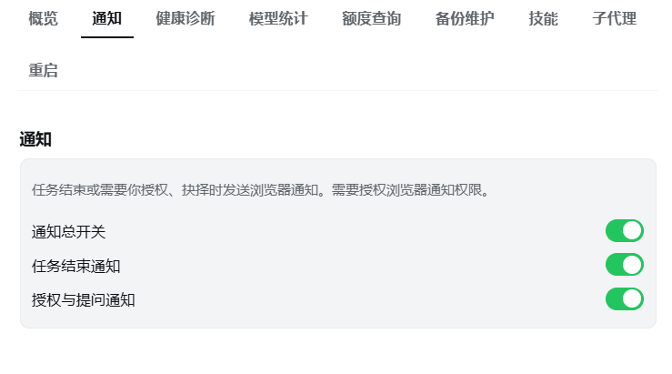

- 主会话完成一轮任务、或会话需要授权 / 审阅计划 / 回答问题时发送浏览器通知；子代理完成任务不发送完成通知；点击通知聚焦页面
- 子代理触发授权 / 审阅计划 / 回答问题时仍发送浏览器通知
- 四档独立开关：总开关、任务完成、授权与提问、输入框铃铛显隐
- 对话栏铃铛一键开关总通知；所有开关刷新后保持

### 会话管理

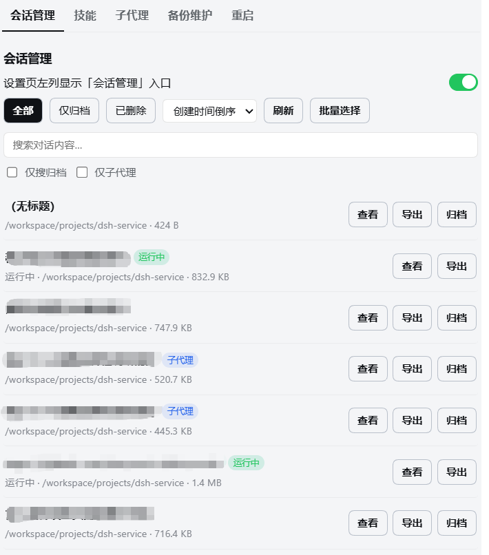

- **查看**：列出运行中、冷会话与已归档会话，显示工作区、事件数与体积；支持时间 / 标题排序及按项目分组，默认显示仅归档。
- **详情**：分页浏览 Markdown 正文，系统事件和工具消息可折叠；返回列表保留滚动位置。
- **子代理筛选**：支持「仅子代理」与批量「选中子代理」，普通 fork 不误判为子代理。
- **导出**：单项或批量下载官方完整 ZIP，每份包含子代理与附件。
- **归档与恢复**：单项或批量归档非运行中会话；DSH ≥0.1.6 支持恢复归档，老宿主仅支持单向归档。
- **内容搜索**：跨会话搜索正文，支持大小写不敏感与灵活空白匹配；可限定归档区，跳转命中上下文并切换上一个 / 下一个命中。
- **删除**：仅已归档会话可删除，运行中会话再次校验并拒绝；两段式确认列出 ID、标题、工作区与体积，删除后同步官方侧栏。
- **已删除记录**：可查看并单条 / 批量清除；记录只含标题与时间，不含正文、不能恢复会话。
- 入口：维护 → 会话管理；设置栏快捷入口默认关闭。

### 移动端适配

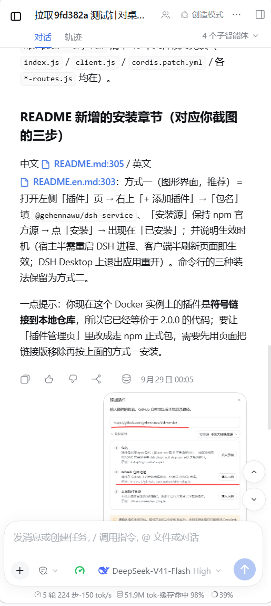

- 默认关闭；开启后仅在视口 <1024px 生效，桌面不受影响。
- 支持侧栏抽屉、窄屏设置导航和全屏面板，适配模型选择、会话任务菜单与 Agent Team 弹窗。
- **滑动沉浸阅读**：下滑收起头部和输入框，上滑、回到底部或聚焦输入框恢复；流式更新不会误触发。
- **抽屉手势**：右滑打开侧栏，左滑打开右侧栏，反向滑动关闭；编辑器横向滚动不误触发。
- 上箭头可逐条跳到上一条用户消息，未加载历史时自动补齐。
- 长会话 JSON 响应自动压缩，并处理安全区与手机输入框聚焦缩放。

### 模型厂家图标

- 模型按钮、模型选择列表与额度卡片显示渠道厂家图标；未识别渠道保留官方默认图标。
- 覆盖 pi-ai 常用内置厂家，以及 Ollama、vLLM、LM Studio、Perplexity、Cohere、火山引擎、豆包、混元、阶跃、Cline 等渠道。
- 自定义渠道名按前缀 / 别名识别，例如 `openrouter-f`、`zai-coding-cn`、`command-goat`、`cline-official`。
- 名称无法识别时，可按额度页**手动选择的适配类型**匹配；名称匹配优先，CLIProxyAPI 图标需手动适配后显示。
- 图标内置，离线可用，不向第三方发送渠道名称；开关在插件配置 → 交互，默认开启。
- 来源：[LobeHub Icons](https://github.com/lobehub/lobe-icons)（MIT）与 [Simple Icons](https://github.com/simple-icons/simple-icons)（CC0）。品牌图形归各厂商所有。
- 全部图标与渠道匹配规则见[图标目录](docs/model-icons.html)。

### 右栏文件编辑

- 官方右侧栏的文件预览头部**右上角多一个「编辑」按钮**（紧邻渲染器名），点一下就进编辑模式：等宽编辑器，带脏标记、`Ctrl/Cmd + S` 保存、「重新加载」「撤销保存」，以及一键「预览」返回官方渲染器
- 另外两条等价入口：原来的**渲染器下拉**里选「编辑」，以及**右键标签 → ⋯ 菜单 →「编辑」**（后者走官方菜单座、不做任何 DOM 注入，是头部按钮失效时的兜底路径）；处于编辑档位时头部按钮自动收起，不会重复
- **不改变官方渲染器的默认地位**：`.md`、`.js` 等官方有专属渲染器的后缀默认仍是官方预览（Markdown / 代码…）；只有官方没有专属渲染器、本来落到「纯文本」的后缀（如 `.txt`、`.log`、`.conf`）才默认进编辑器。官方预览未挂载（旧版 DSH）时整块静默不出现
- **写盘走会话自己的文件服务与沙箱策略**：浏览器只送 `dsh-resource://file/session/<会话>/<路径>` 资源地址，会话与工作区根由宿主解析，不接受自由路径；保存携带读取时的版本号，**磁盘已被 Agent 或其他窗口改过就拒绝覆盖**，由你选「重新加载（丢弃修改）」或「用我的内容覆盖」；只读沙箱会话只能预览
- **保存不中断输入**：保存期间仍可继续编辑，响应只确认本次提交的内容，后续输入保留为「未保存」；状态区分「保存中 / 未保存 / 已保存」。冲突出现后仍可修改，覆盖保存使用编辑器里的最新草稿
- **离开前保护草稿**：通过编辑器自己的「预览」「重新加载」按钮离开或重读时，若有未保存内容先显示内联确认，可取消继续编辑；「撤销保存」也先确认，且保留版本守卫，不静默覆盖磁盘上的新改动
- 单文件上限 2 MiB（超过只读）；会话未激活或沙箱策略服务不可用时不可编辑（仍可使用官方预览）
- 首版**不做**：语法高亮、多光标、查找替换（插件半没有打包器，借不到编辑器组件），关闭标签不弹未保存确认
- 开关在 插件 → 插件配置 → 交互（默认开，热生效）

### 外部探活

- `GET` / `HEAD /healthz` 返回空 200，其他方法返回 405
- 适合 Uptime Kuma、Docker、Kubernetes 等外部监控

## 🏗️ 架构

插件是 Cordis 双半结构：**Host 端（`index.js`）** 承担一切能力与数据访问，**Client 端（`client.js`）** 只在浏览器渲染界面；两侧经 Typert JSON-RPC 通信，通道为单层绝对路径 `/dsh-service`，authority 一律 `loopback`。

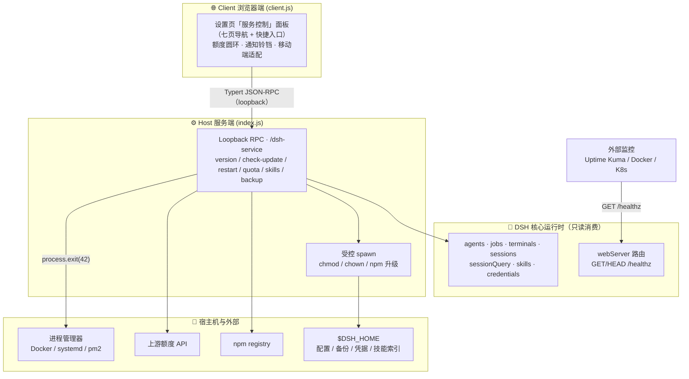

关键契约：

- **仅 loopback**：能力只经 `/dsh-service` loopback channel 暴露；webServer 路由只返回不含信息量的状态码
- **重启 = `process.exit(42)`**：插件只发退出信号，由外层进程管理器拉起；没有管理器时重启无保障
- **零输入拼接**：浏览器侧不接受 URL / 包名 / 命令 / 路径，命令全部走宿主侧白名单
- **凭据不出宿主**：API key 只在宿主进程内解析，浏览器只收到归一化窗口数据

## ⚡ 安装

### 方式一：DSH 插件管理页（图形界面，推荐）

1. 打开左侧边栏的「**插件**」页。
2. 点右上角的「**+ 添加插件**」按钮。
3. 在弹窗里按来源**三选一**填写（同一个输入框接受三种形式，底部提示会随填写内容变化）：
   - **npm 包名（推荐）**：`@gehennawu/dsh-service@2.0.9`——**带上精确版本号**（写法 `包名@版本号`）；
   - **GitHub 仓库地址**：`https://github.com/gehennawu/dsh-service`（公开仓库，无需令牌；`github:gehennawu/dsh-service` 简写同样可用）；
   - **本地插件目录**：本机上的绝对路径，例如 `/path/to/dsh-service`（自研或已下载的插件）。
4. 「**安装源**」按网络情况选择：默认「**npm 官方源**」；国内网络拉取受限时可选「**中国大陆镜像源**」（影响走包名安装时的拉取源，GitHub 地址与本地目录不受其影响）。
5. 点「**安装**」，等待官方把包装进当前 profile（弹窗底部会给出进度与结果）。
6. 装好后本插件出现在「**已安装**」分组里。宿主半要等 DSH 进程重启才生效，客户端半刷新页面即生效。
   - 在 Web 上：用本插件的「**服务控制 → 重启**」，或在对话里发 `/restart`；
   - 在 DSH Desktop 上：请退出应用后重新打开（桌面端由应用自身托管进程，本插件不会自行退出）。

> 提示：三种形式都走官方安装链路，无需手动改 profile 文件；图形界面填 GitHub 地址与命令行 `github:` 前缀等价。

> **npm 方式为什么建议带版本号**：pnpm 11 默认启用供应链发布观察期（`minimumReleaseAge`，1440 分钟）。**不带版本号**（含 `@latest`）时，发布时间未满观察期的版本不会被自动安装，包管理器会退到「最近的、已过观察期的那一版」——插件页因此可能提示「本次安装的是 x.y.z，而非最新版本 a.b.c」；**写精确版本号**（如 `@gehennawu/dsh-service@2.0.9`）才会安装你点名的那一版。观察期属供应链安全策略，不代表新版有问题；不着急时等满 24 小时，不带版本号安装同样会装到新版。

### 方式二：命令行

| 方式 | 命令 |
| --- | --- |
| npm（推荐） | `dsh plugin --profile web add @gehennawu/dsh-service@2.0.9` |
| GitHub | `dsh plugin --profile web add github:gehennawu/dsh-service` |
| 本地开发 | `dsh plugin --profile web add link:/path/to/dsh-service` |

命令行走 npm / pnpm 的默认源；需要镜像时，请先按 npm / pnpm 的常规做法把 registry 指到镜像站，再执行上面的命令。npm 方式同样受 pnpm 发布观察期影响：不带版本号会装到最近的、已过观察期的版本，写精确版本号（`@gehennawu/dsh-service@2.0.9`）才会装该版（原因见「方式一」的提示）。

安装或更新后重启 DSH Web：

```sh
dsh web
```

打开 DSH Web 设置页，进入**服务控制**。

## 🔄 自动重启配置

插件只发送退出信号，不负责拉起进程；没有进程管理器时重启会直接停止 DSH Web。

插件以被动信号（环境变量、`/.dockerenv`、`/proc/1/cgroup`、终端 TTY）判断进程管理器：检测到 Docker/systemd/pm2/supervisord/Kubernetes 时照常自动重启；都没有且 stdin/stdout 为交互终端时视为「疑似手动启动」——健康诊断黄色标注、一键升级改为保持运行并提示手动重启。启发式无法覆盖输出重定向、NSSM/WinSW 等场景，可用 `DSH_SERVICE_RUNTIME_ENV=managed|manual|desktop` 显式声明。

### Docker Compose

```yaml
services:
  dsh:
    restart: unless-stopped
```

### systemd

```ini
[Service]
ExecStart=/usr/local/bin/dsh web --host 127.0.0.1
Restart=on-failure
RestartSec=2
```

### pm2

```sh
pm2 start "dsh web --host 127.0.0.1" --name dsh-web
```

## 🖥️ 平台支持

| 环境 | 插件功能 | 重启后自动拉起 | 验证状态 |
| --- | --- | --- | --- |
| Linux + Docker Compose | 支持 | 配置 restart policy 后支持 | 已验证 |
| Linux + systemd / pm2 | 预期支持 | 由进程管理器负责 | 未单独验证 |
| macOS / Windows + pm2 等 | 代码未限制 | 由进程管理器负责 | 未验证 |
| DSH Desktop（Windows，Electron） | 支持 | 由桌面应用负责 | 已验证（2026-09-28 真机） |
| DSH Desktop（macOS / Linux，Electron） | 代码未限制 | 由桌面应用负责 | 未验证 |
| 直接运行 `dsh web` | 支持 | 不支持 | 预期行为 |

运行要求：Node.js `>=22`，DSH Web 能加载 Host 与 Client 两半插件。更新检查需访问 `registry.npmjs.org`；网络失败不影响其他功能。

**DSH 兼容范围**：`>=0.1.1-rc.2 <0.2.1-alpha.4`，已适配 `0.2.1-alpha.3`。新版会话格式不能由旧版 DSH 读取，**备份不可跨版本降级恢复**。


**DSH Desktop**：重启与恢复后的重启改为提示退出应用后重新打开；一键升级使用桌面应用自带的插件管理页。通知需授予系统权限，点击通知可能无法唤回隐藏窗口，请用托盘打开。其他平台尽力而为，不承诺兼容。

## 🔒 安全设计

| 领域 | 边界 |
| --- | --- |
| 输入 | 浏览器不能传入 URL、包名、命令或文件路径。**唯一例外**：右栏文件编辑只接受 `dsh-resource://file/session/<会话>/<路径>` 资源地址（逐段解码、拒绝其他形态），会话与工作区根一律宿主侧解析，写盘再经会话沙箱策略围栏 |
| 网络 | 更新检查只访问固定 npm registry 地址 |
| RPC | 仅接受 loopback 调用，数据不出本机 |
| 数据 | 用量索引不保存消息、Prompt、工具参数或凭据；API key 只在宿主进程内使用 |
| 操作 | 破坏性操作（重启、删除、修复权限）均需两段式确认 |
| 凭据 | 写入 DSH 凭据库（`$DSH_HOME/.credentials.yaml`），只发往固定端点 |

## ❓ 常见问题 FAQ

<details>
<summary><strong>重启后没有自动起来？</strong></summary>

插件只发送退出信号，重新拉起由进程管理器负责（见「自动重启配置」）。面板标注「疑似手动启动」时，直接运行 `dsh web` 的终端进程会被退出；请改用 Docker Compose / systemd / pm2 托管。
</details>

<details>
<summary><strong>健康诊断里的黄色「重启无保障」警告是什么？</strong></summary>

这是「疑似终端手动启动」的检测结果，说明当前没有检测到进程管理器。若实际由 NSSM/WinSW 或输出重定向等场景托管，可用 `DSH_SERVICE_RUNTIME_ENV=managed` 显式声明消除。
</details>

<details>
<summary><strong>桌面端（DSH Desktop）收不到任务通知？</strong></summary>

先确认两件事：① 「配置 → 通知」里的**通知总开关**必须真正打开——它默认关闭，只有点过「开启通知」且系统授予权限后才会置为开启（若只看到「开启通知」按钮，说明权限还没授予）；② 会话必须真的从「运行中」变为结束，且不是子代理会话。系统通知在桌面端本身是可用的：Windows「设置 → 系统 → 通知」里会为应用建立一条 `electron.app.DeepSeek Harness` 记录（真机实测会弹出「任务完成」通知）。唯一已知边界是**点击通知不会把窗口唤回**——桌面端关窗=隐藏窗口，当前桌面桥面没有窗口显示 API，请用系统托盘唤回窗口。
</details>

<details>
<summary><strong>额度卡片显示「凭据未配置」？</strong></summary>

点击卡片上的内联表单写入凭据：普通适配填 API key，CLIProxyAPI 填管理密钥（不是代理 key），小米 Token Plan 填控制台 Cookie。写入 DSH 凭据库后自动强制刷新；被进程环境变量遮蔽时宿主会拒绝写入，需改环境变量本身。凭据填错或需要轮换时，已配置的卡片在「配置」区同样有「修改凭据（已配置）」入口，可直接覆盖或清除已存值。
</details>

<details>
<summary><strong>CLIProxyAPI 卡片显示「已被 CLIProxyAPI 暂时封禁」？</strong></summary>

管理密钥连续填错触发了 CPA 的 fail2ban：同一 IP 失败满 5 次封 30 分钟，封禁期间**正确密钥也会被拒**，且该状态不提供重填入口（密钥本身没问题）。等封禁到期（上游原话里带剩余时间），或更换 DSH 宿主机的出口 IP 后，点卡片「重试连接」即可恢复。封禁只作用于 `/v0/management` 管理面，走这台 CPA 的模型推理不受影响。
</details>

<details>
<summary><strong>Command Code 卡片显示「凭据被上游拒绝」？</strong></summary>

推理面和额度面共用同一把 key（`user_*` 前缀，Studio 的 API keys 页生成）。卡片显示该错误说明 key 被上游判为无效：到 commandcode.ai 的 Studio 重新生成或复制 key，点卡片「填写 API 密钥」粘贴即可。若渠道 baseURL 指向的是自建中转而非 `api.commandcode.ai`，额度面仍固定查官方账号面——中转 key 查不到官方额度。
</details>

<details>
<summary><strong>小米卡片显示「凭据被上游拒绝」？</strong></summary>

网页登录态过期了。重新登录 platform.xiaomimimo.com，从任意 `/api/v1/tokenPlan/` 请求复制 `Cookie:` 头，点卡片「填写控制台 Cookie」重新粘贴。
</details>

<details>
<summary><strong>StepFun Step Plan 卡片显示「凭据未配置」？</strong></summary>

Step Plan 订阅没有 API-key 形态的查询接口，需要网页登录态令牌。登录 platform.stepfun.com，按 F12 打开开发者工具 → Application → Cookies → platform.stepfun.com，复制 `Oasis-Token` 的完整值（形如 `xxx...yyy`，两个小圆点分隔是令牌格式本身的一部分，不要拆分），点卡片「填写控制台令牌（Oasis-Token）」粘贴即可；`Oasis-Webid` 由宿主从令牌自动派生，无需手填。
</details>

<details>
<summary><strong>StepFun Step Plan 卡片显示「凭据被上游拒绝」？</strong></summary>

令牌过期了（官方常见报错 `oasis-token is embezzled` 即令牌与 web_id 不匹配）。重新登录 platform.stepfun.com 后从 Cookies 复制新的 `Oasis-Token` 完整值再粘贴；从控制台复制时若自带 `Oasis-Token=` 或 `Cookie: ` 前缀会被自动剥离，不影响。
</details>

<details>
<summary><strong>恢复备份会怎样？</strong></summary>

先做完整性检查并展示恢复预检计划，再由用户最终确认。提交前宿主会复检备份 SHA-256、当前目标指纹与运行中工作；任何变化都会中止，不会部分覆盖或重启。提交成功后会话目录整体替换，允许的配置文件按快照精确替换，profile 按预检里的目标选择恢复（跨名映射默认只恢复 Profile 配置层、不覆盖本机插件清单，勾选后才覆盖；node_modules、凭据、附件不动）。受 Docker/systemd/pm2 等托管时自动重启；疑似终端手动启动时显示手动重启指引。删除备份同样需要两段式确认。
</details>

<details>
<summary><strong>技能开关为什么置灰不可点？</strong></summary>

该技能来自内置（bundled）只读目录。只有 `project-*` 与 `user-*` 来源的技能支持双向开关。
</details>

<details>
<summary><strong>保存技能开关提示「技能文件刚刚发生变化」？</strong></summary>

并发保护生效：SKILL.md 刚被外部编辑器改动（版本比对失败）。点击「刷新」获取最新状态后重试即可。
</details>

<details>
<summary><strong>插件管理页装了插件，版本却停在旧版？</strong></summary>

pnpm 11 默认启用供应链发布观察期（`minimumReleaseAge`，1440 分钟）：安装时**不带版本号**（含 `@latest`）只会选「发布时间已满观察期的最新版」，刚发布的新版会被跳过，官方插件页会提示「本次安装的是 x.y.z，而非最新版本 a.b.c」。要立刻装上新版：在插件管理页卸载后按 `包名@版本号` 重装（例如 `@gehennawu/dsh-service@2.0.9`），或直接用本插件的「**服务控制 → 一键升级**」——它按精确版本安装，不受观察期影响。观察期属供应链安全策略（新发布版本可能含尚未被发现的缺陷），等满 24 小时后不带版本号安装也会自然装到新版。
</details>

<details>
<summary><strong>更新检查失败会影响其他功能吗？</strong></summary>

不会。更新检查只是访问 npm registry 的只读请求，失败静默忽略，其余功能不受影响。
</details>

## 🤝 参与贡献

欢迎提交 Issue 与 Pull Request。开发路线与技术约定见仓库内 AGENTS.md；发布规范见 AGENTS.md「发布」一节。

## 📄 许可证

[MIT](./LICENSE)